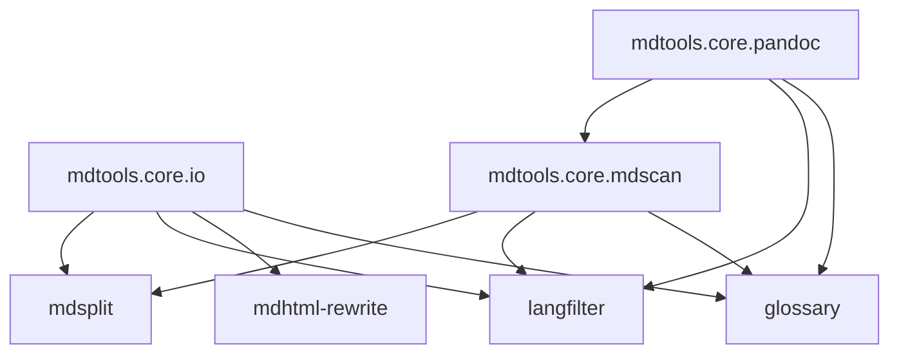

`mdtools.core` は、各ツールに重複していた I/O、Markdown スキャン、Pandoc/Quarto 属性処理を集約した内部共通パッケージです。公開 CLI は維持し、内部実装だけを共有しています。

実施記録は [docs/plans/core-refactor.md](docs/plans/core-refactor.md) にあります。用語としての []{.term id=mdtools-core} は `docs/glossary/defs.yaml` でも管理します。

仕様管理機能の開発は [仕様記述契約 v1](docs/spec/contract-v1.md) を基準に進めます。
要件ブロック、共有定義、生成IR、出典・診断と既存CLIの責務境界、およびM1〜M9の対応範囲を記載しています。
[キャンセル要件の例](docs/spec/examples/cancellation/README.md) も参照してください。
M1 / #23のWorkspace設定v1と`mdtools.workspace.load_workspace()`は、明示登録した原典・共有定義と生成物を区別して解析対象を決定します。
[実行可能な設定例](docs/spec/examples/cancellation/mdtools.toml) と契約の「Workspace設定 v1」を参照してください。新しい仕様解析・検査CLIは後続Milestoneで実装します。
M1 / #24は`mdtools.core.source`のsnapshot・1-based位置・半開範囲と、`snapshot_sources(workspace)`、`mdsplit.compose.compose_with_source_map()`を提供します。
位置対応はcompose単独までで、生成見出し等は合成位置、langfilter・glossary等の後段変換は未対応です。詳細は契約の「出典と診断の共通契約」を参照してください。

M1 / #25は`mdtools.core.diagnostics`の共通診断・明示的な検査状態・決定的なテキスト/JSON v1出力と、`mdtools.diagnostics.inspect_workspace()`の最小利用経路を提供します。
API・分類・位置なし診断・根拠・表示規則は契約の「M1 / #25 診断APIと検査状態」以降、機械可読形式は[診断JSON v1スキーマ](docs/spec/diagnostics-v1.schema.json)を参照してください。
#31の断片末尾CR＋次断片先頭LFによるmap構築失敗は未解消で、この経路の正確な原稿追跡は保証しません。通常のCRLF本文全般の問題ではありません。
