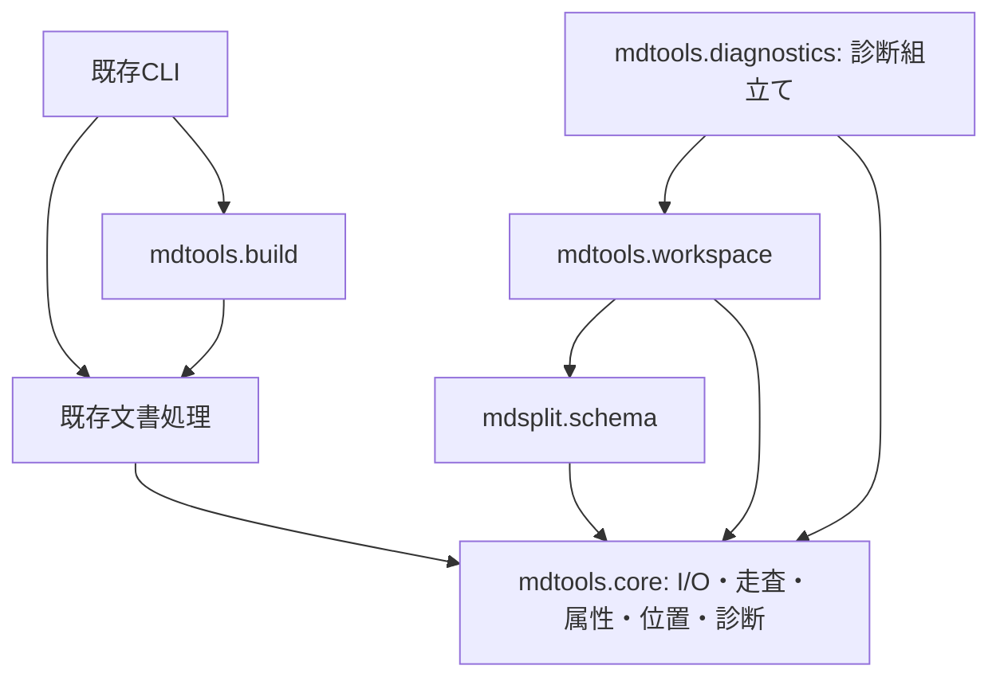

`mdtools.core` は、各ツールに重複していた I/O、Markdown スキャン、Pandoc/Quarto 属性処理を集約した内部共通パッケージです。公開 CLI は維持し、内部実装だけを共有しています。



矢印はimport・API利用の方向です。workspaceは文書階層を知る原典選択の組立て層、`mdtools.diagnostics`はWorkspace固有エラーの診断組立て層としてcoreの外に置きます。core・文書処理からCLI・組立て層・将来のspec/backendへ逆依存しません。要件ID解決・要件や制約の意味・検査計画は将来のspec層の責務です。

実施記録は [docs/plans/core-refactor.md](docs/plans/core-refactor.md) にあります。用語としての []{.term id=mdtools-core} は `docs/glossary/defs.yaml` でも管理します。

仕様管理機能の開発は [仕様記述契約 v1](docs/spec/contract-v1.md) を基準に進めます。
要件ブロック、共有定義、生成IR、出典・診断と既存CLIの責務境界、およびM1〜M9の対応範囲を記載しています。
[キャンセル要件の例](docs/spec/examples/cancellation/README.md) も参照してください。
M1 / #23のWorkspace設定v1と`mdtools.workspace.load_workspace()`は、明示登録した原典・共有定義と生成物を区別して解析対象を決定します。
[実行可能な設定例](docs/spec/examples/cancellation/mdtools.toml) と契約の「Workspace設定 v1」を参照してください。新しい仕様解析・検査CLIは後続Milestoneで実装します。
M1 / #24は`mdtools.core.source`のsnapshot・1-based位置・半開範囲と、`snapshot_sources(workspace)`、`mdsplit.compose.compose_with_source_map()`を提供します。
位置対応はcompose単独までで、生成見出し等は合成位置、langfilter・glossary等の後段変換は未対応です。詳細は契約の「出典と診断の共通契約」を参照してください。

M1 / #25は`mdtools.core.diagnostics`の共通診断・明示的な検査状態・決定的なテキスト/JSON v1出力と、`mdtools.diagnostics.inspect_workspace()`の最小利用経路を提供します。
API・分類・位置なし診断・根拠・表示規則は契約の「M1 / #25 診断APIと検査状態」以降、機械可読形式は[診断JSON v1スキーマ](docs/spec/diagnostics-v1.schema.json)を参照してください。
#31の断片末尾CR＋次断片先頭LFによるmap構築失敗は未解消で、この経路の正確な原稿追跡は保証しません。通常のCRLF本文全般の問題ではありません。

M1 / #26ではCLI内のbuild本体を`mdtools.build.build_document()`へ、mdsplitの存在チェックを`mdsplit.verify.verify()`へ分離しました。例えば`build_document(input_text="本文", lang="ja")`はCLI・stdinを経由せず文字列を返し、`verify(hierarchy_path)`はsection数と欠落参照を返します。既存の独立した処理APIと互換入口は維持します。責務表、将来の解析サービス・backend・CLI・LSPホストの境界、例外と互換性の詳細は契約の「依存方向と既存CLIの互換性」を参照してください。

M2 / #35では`mdtools.spec.model` / `mdtools.spec.results`に要件・共有宣言・明示参照・ローカル/全体解析結果の不変データ契約を追加しました。M1の出典・診断を再利用し、部分結果と式未検査を保持します。契約の「M2 / #35 仕様モデルと解析結果」「M2 index/showの入出力・診断契約」と[小さなfixture](docs/spec/examples/model-contract/README.md)を参照してください。

M2 / #36の`mdtools.spec.parser.parse_requirements(snapshot)`は、元の単一原稿・section原稿から要件、言語別本文、最大1個のmdspec、refs/usesと原稿位置を抽出し、`LocalAnalysis`を返します。Workspaceで選んだ各snapshotを個別に渡し、compose・言語抽出・glossary置換前に解析します。構造不正は診断と部分結果に残し、壊れたモデルをnatural-onlyにしません。参照解決と式・論理検査は理由付きnot-runです。

```python
from mdtools.workspace import load_workspace, snapshot_sources
from mdtools.spec.parser import parse_requirements

workspace = load_workspace("docs/spec/examples/cancellation/mdtools.toml")
results = tuple(parse_requirements(source) for source in snapshot_sources(workspace))
assert [req.key.name for result in results for req in result.requirements] == [
    "REQ-CANCEL-ALLOW", "REQ-CANCEL-DENY", "REQ-CANCEL-GUIDANCE",
]
```

このAPIはCLI・任意依存・ファイルI/Oを必要としません。上例の読込はWorkspace側で行います。共通サービス・SpecIR（#39）、spec CLI（#40）は後続Issueです。

M2 / #37の`mdtools.spec.loader.load_definitions(snapshot, kind=..., format=...)`は、明示登録したspec/glossaryの元snapshotから共有宣言・表示データ・明示参照・出典・診断を`LocalAnalysis`へ収集します。重複候補を上書きせず、不正な宣言やentryを原文の拒否断片へ残します。JSONは追加依存不要、YAMLは任意のPyYAMLを使い、anchor/alias/merge/tag/複数文書は未対応とします。既存glossary CLIの後勝ち・警告は変更しません。

```python
from mdtools.diagnostics import read_definition_source
from mdtools.spec.loader import load_definitions
from mdtools.workspace import load_workspace

workspace = load_workspace("docs/spec/examples/model-contract/mdtools.toml")
results = tuple(
    load_definitions(read_definition_source(item.path), kind=item.kind,
                     format=item.path.suffix.lower().removeprefix("."))
    for item in workspace.definitions
)
assert [len(result.nodes) for result in results] == [4, 2]
assert all(result.completeness == "complete" for result in results)
assert all(result.checks.references.status == "not-run" for result in results)
```

読込失敗は`DefinitionReadError.report`の共通診断へ返し、存在しないsnapshotを作りません。構造・ローカル宣言値がcompleteでも、名前付き型の値所属・参照解決は#38、式・論理はM3の未検査です。対応能力、回復境界、読込失敗の扱いは契約、実fixtureと出典の検証は[チェックリスト](mdtools/spec/tests/README.md#issue-37-厳格ローダーの検証チェックリスト)を参照してください。

M2 / #38の`mdtools.spec.resolver.resolve_analyses(local_results)`は、全収集結果から名前空間ごとのレジストリと明示参照の`SpecGraph`を構築します。全候補を保持して未定義・曖昧・種別不一致を区別し、列挙型定数の値所属も検査します。読み取り専用の`resolved.registries`、全体checks/completeness、元snapshotとローカル診断を含む`resolved.report`を返します。

```python
from mdtools.spec.resolver import resolve_analyses

# 上のloader例で得た仕様定義とglossaryを結合する。
resolved = resolve_analyses(results)
assert resolved.completeness == "complete"
assert resolved.checks.references.status == "passed"
assert resolved.registries["declaration"]["paid"][0].name == "paid"
assert all(check.status == "not-run" for check in resolved.checks.expressions)
```

入力順と原稿のID・全出現・全明示参照を保持し、自己参照や循環を展開しません。入力が不完全なら個別参照が解決できても全体の参照検査をpassedにしません。APIはファイルを再読込せず、Workspaceの登録漏れ検出・サービス/IR/Schema（#39）、spec CLI（#40）、式・論理検査（M3）へ進みません。判定順・組み込み型・診断抑制・状態集約は契約、受け入れ条件との対応は[#38チェックリスト](mdtools/spec/tests/README.md#issue-38-specgraphの検証チェックリスト)を参照してください。
