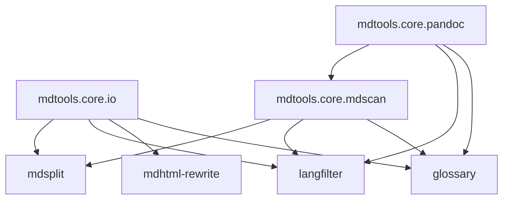

`mdtools.core` は、各ツールに重複していた I/O、Markdown スキャン、Pandoc/Quarto 属性処理を集約した内部共通パッケージです。公開 CLI は維持し、内部実装だけを共有しています。

実施記録は [docs/plans/core-refactor.md](docs/plans/core-refactor.md) にあります。用語としての []{.term id=mdtools-core} は `docs/glossary/defs.yaml` でも管理します。

仕様管理機能の開発は [仕様記述契約 v1](docs/spec/contract-v1.md) を基準に進めます。
要件ブロック、共有定義、生成IR、出典・診断と既存CLIの責務境界、およびM1〜M9の対応範囲を記載しています。
[キャンセル要件の例](docs/spec/examples/cancellation/README.md) も参照してください。
M1 / #22は契約と例の文書化であり、新しい仕様解析・検査CLIは後続Milestoneで実装します。
