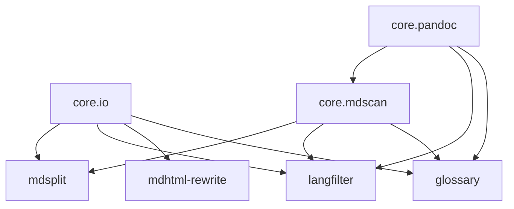
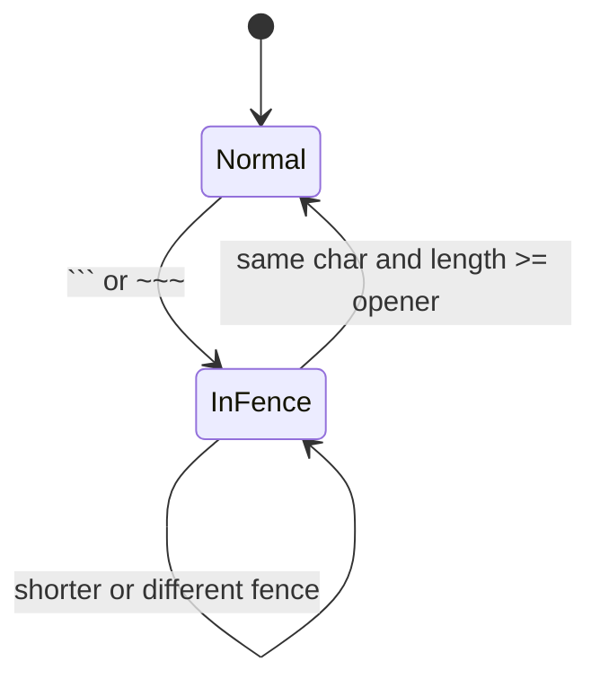

# mdtools.core リファクタ実施記録

`mdtools.core` は、mdtools の各ツールに重複していた I/O、Markdown スキャン、Pandoc/Quarto 属性処理を共通化するために追加した内部パッケージです。この文書は初期計画ではなく、現在の実装結果と設計判断を記録します。

## 背景

`mdsplit`、`langfilter`、`mdhtml-rewrite`、`glossary` はそれぞれ独立した CLI として始まりました。glossary 追加後、以下の重複が目立つようになりました。

- stdin/stdout と UTF-8 ファイル I/O
- JSON/YAML 読み書きと `ensure_ascii=False, indent=2` の JSON 出力
- Markdown code fence の状態追跡
- Pandoc/Quarto 属性の正規表現とパース処理

これらを []{.term id=mdtools-core} に集約し、公開 CLI は維持したまま内部実装だけを整理しました。

## 最終構成



### core.io

`mdtools.core.io` は text/JSON/YAML の共通 I/O を提供します。CLI の stdin/stdout 処理、JSON report の読み書き、glossary 定義ファイルの読み込みに使います。

主な API:

- `read_text_or_stdin(path)`
- `write_text_or_stdout(text, path)`
- `read_json(path)` / `write_json(path, obj)`
- `dumps_json(obj)`
- `read_structured_file(path)`
- `StructuredFileError`

### core.mdscan

`mdtools.core.mdscan` は Markdown 行を code fence 内外で分類します。`scan_md_lines()` / `scan_md_lines_from_list()` は多くの caller が使う高レベル API です。`mdsplit` のように `<pre>` など caller 固有の除外領域を先に扱いたい場合は、`CodeFenceTracker` を直接使います。



### core.pandoc

`mdtools.core.pandoc` は Pandoc/Quarto 由来の構文を共有します。

- `CODE_FENCE_RE`
- `FENCE_CLOSE_RE`
- `DIV_OPEN_RE`
- `BRACKETED_SPAN_RE`
- `parse_attrs()`
- `PandocAttrs`

`parse_attrs()` は class と key-value を順序に依存せず抽出します。そのため `::: {.note lang=en}` や `::: {.note .glossary filter=term}` のような属性順序でも、`langfilter` と `glossary` は意図した属性を扱えます。

## 採用した仕様改善

リファクタ中に master 実装との差分がいくつか見つかりました。最終的には、Markdown/Pandoc 的に自然な挙動は新仕様として採用し、共通化で caller 固有の優先順位を壊した箇所だけ修正しました。

| 領域 | 現在の仕様 |
|------|------------|
| langfilter | `lang` 属性は属性順序に依存しない |
| langfilter | `::: {lang=en} trailing` は Pandoc fenced div として扱わない |
| langfilter | code fence 内の `:::` では lang block を閉じない |
| glossary | `.glossary` class は属性順序に依存しない |
| glossary | glossary block 内 code fence の `:::` では block を閉じない |
| mdsplit | `<pre>` 内では Markdown code fence marker を追跡しない |
| mdscan | opener より短い closing fence では code fence を閉じない |

## 実装の流れ


1. `core.io` を追加し、CLI と JSON/YAML I/O を移行しました。
2. `core.mdscan` を追加し、code fence 追跡を共有しました。
3. `core.pandoc` を追加し、Pandoc/Quarto 属性処理を共有しました。
4. `CodeFenceTracker` を追加し、`mdsplit` が `<pre>` 優先順位を維持できるようにしました。
5. 仕様改善として採用する差分をテスト名と README で明示しました。

## テスト結果

初回coreリファクタ時の検証結果は次の通りです。

```bash
uv run pytest -q
```

結果:

```text
190 passed, 1 skipped
```

追加された core テストは以下を守ります。

- `core.io`: stdin/stdout、UTF-8、JSON/YAML、エラー処理
- `core.mdscan`: code fence の開閉、短い closing fence、trailing newline 保持
- `core.pandoc`: 属性順序、class/key-value、fenced div と bracketed span

## 今後の候補

- help epilogやargparse設定の共通化（必要ならCLI側に置き、coreへ処理からの逆依存を作らない）
- `mdtools.core.tree`: `mdsplit` の tree traversal helper の切り出し
- `mdtools.core.html`: `mdhtml-rewrite` の HTML 正規表現と model helper の整理

これらは今回の core refactor の範囲外です。公開 CLI と既存ファイル形式の互換性を優先して、必要になった段階で小さく切り出します。

## M1 / #26 責務境界の整理

PR #30は`76f224d`、PR #32は`c9cbac3`でMilestoneへマージ済み。#32のSchema/Python文字列制約の指摘は`1610831`で修正・再レビュー済みで、dev用Draft 2020-12 validatorと122件の回帰を維持した。クリーンな作業ツリーから`origin/milestone/m1-foundation`の`c9cbac3`を取得し、`issue/26-core-boundaries`を作成した。別sub-issueブランチからは分岐していない。着手時の全テストは`512 passed, 1 skipped`。skipは外部combined.md未配置。

実際のimport調査と変更判断:

| 調査した経路 | 調査結果と対応 |
|--------------|----------------|
| core | ioは標準ライブラリと任意YAMLの遅延読込、mdscan→pandoc、diagnostics→source。CLI・spec・文書処理への逆依存なし。既存モデルを維持 |
| workspace | core.sourceとmdsplit.schemaを利用。文書階層を知る原典登録の組立てなのでcoreへ移動しない |
| mdtools.diagnostics | workspace→snapshotの結果とWorkspaceErrorをcore診断へ組み立てる。workspace/coreからの逆importなし。配置を維持 |
| 文書処理 | compose/decompose、filter_lang、glossaryのload/resolve/find_missing/list、HTML inventory/rewrite/convertは既にCLIなしで利用可能。既存配置と副作用を維持 |
| build | build_cli内でcompose/filter_lang/load/resolveを順に実行していた。処理順・中間ファイル・再読込をmdtools.buildへ分離し、CLIは引数、stdin、最終出力、表示、終了コードを担当 |
| mdsplit verify | CLI内だけに再帰存在チェックがあった。mdsplit.verifyへ結果を返す本体を分離し、CLIは従来の一覧表示と0/1終了を維持。Workspaceの厳格検証へ置換しない |
| 公開入口 | pyprojectの5コマンド、統合mainの遅延dispatch、互換__main__、help例・README参照は変更不要。API/設計の説明をREADME・契約の原稿側に追加 |

許されるimportは契約の責務表を正とする。`mdtools.build`は既存文書処理の組立て、`mdtools.workspace`は設定と原典選択、`mdtools.diagnostics`は登録失敗の共通診断化であり、coreへまとめない。coreと文書処理はCLI・組立て・spec・backendへ依存しない。将来の解析サービスがworkspaceのsnapshotとspec処理を組み立て、CLI/LSPホストから共通利用し、外側で任意adapterを渡す。要件ID解決・意味・検査計画はspec内に閉じる。空パッケージや将来用抽象化、大規模移動は追加しない。

#31は調査時もopen。SourceMapBuilderの断片末尾CR＋次断片先頭LFで新しくできるCRLF境界がmap構築に失敗する。通常のCRLF本文全般は対象外。今回も最小例の失敗を確認し、修正を取り込まない。buildはcomposeと中間再読込を維持し、map経路へ切り替えない。該当経路の正確な原稿追跡は保証せず、架空の位置を作らない。後段langfilter/glossaryの位置伝播、atomic snapshot、M2以降の仕様内容検査も未実装のまま。

検証では、処理本体の直接呼出、正常・エラー時のCLI入出力/終了コード、中間ファイルと改行、依存方向と循環の不在、`python -S`でCLI/任意/dev依存を禁止したAPI呼出を追加した。共通位置・診断・公開Schemaの既存回帰、mdscan、mdsplit round-trip、build、既存公開コマンドも全テストで確認した。文書はsection原稿を編集しcanonicalを再生成、hierarchy verify・compose一致・decompose→composeを検証した。

最終ローカル検証は`.venv/bin/python -m pytest -q`で**549 passed, 1 skipped**（基準から37件追加）。新しいCLIや必須依存は追加していない。分岐元c9cbac3との64ケースの比較で、終了コード・stdout・stderr・生成ファイルのbytesが一致した。変更したREADME / mdsplit README / 契約 / 本記録の4文書はhierarchy verify、canonicalとのcompose一致、decompose→compose round-tripを通過。契約の6つのPython例も記載順で実行し、README glossary参照と`git diff --check`を確認した。CIは公開5コマンド・統合helpと4文書のround-tripを確認するよう拡張した。PR先はmilestone/m1-foundation、関連Issueは#26。PRはマージせず、Issueはマージ確認前にCloseしない。
