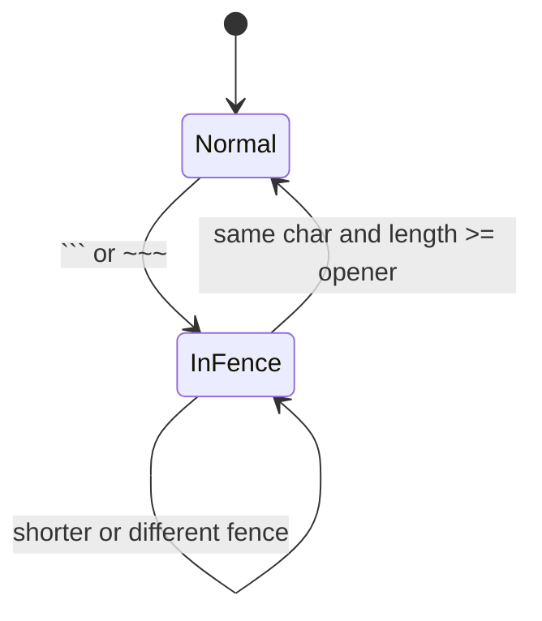

`mdtools.core.mdscan` は Markdown 行を code fence 内外で分類します。`scan_md_lines()` / `scan_md_lines_from_list()` は多くの caller が使う高レベル API です。`mdsplit` のように `<pre>` など caller 固有の除外領域を先に扱いたい場合は、`CodeFenceTracker` を直接使います。

