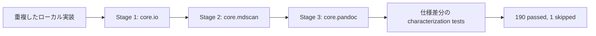

1. `core.io` を追加し、CLI と JSON/YAML I/O を移行しました。
2. `core.mdscan` を追加し、code fence 追跡を共有しました。
3. `core.pandoc` を追加し、Pandoc/Quarto 属性処理を共有しました。
4. `CodeFenceTracker` を追加し、`mdsplit` が `<pre>` 優先順位を維持できるようにしました。
5. 仕様改善として採用する差分をテスト名と README で明示しました。
