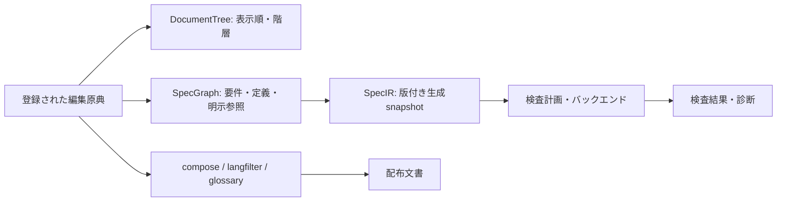
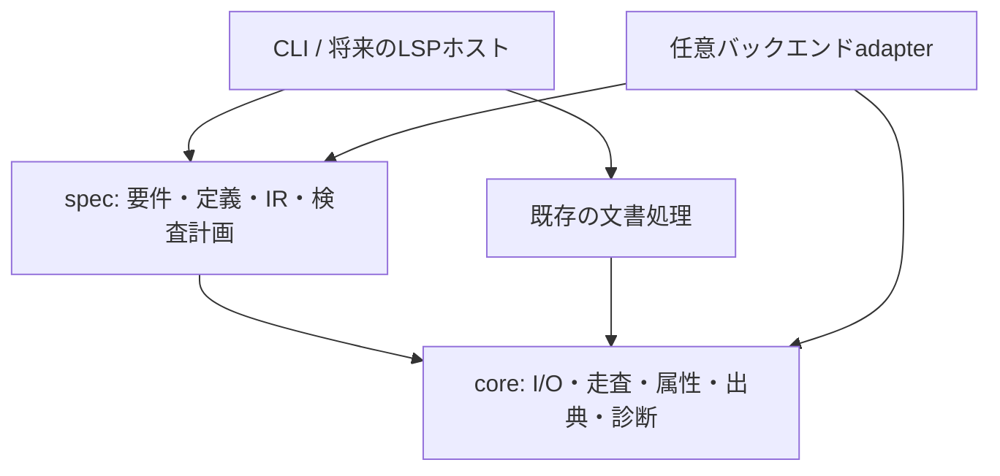

# mdtools 仕様記述契約 v1

契約ID: `mdtools-spec` / 契約版: **1** / 策定: 2026-10-25。

この文書は [M1 / #22](https://github.com/fischerimapig/mdtools/issues/22) の設計成果物である。原稿の書き方と後続実装の責務を定める。**M1 / #22では仕様パーサーや検査CLIは追加しない。**

## 契約の位置付けと適用範囲

本文の「必須」「禁止」は契約v1に対応する実装への要件を示す。「将来」「候補」は予約した拡張点であり、現在の対応機能を示さない。

| 段階 | この契約との関係 |
|------|------------------|
| M1 / #12 | 契約、Workspace、出典、診断、依存方向の基盤。#22は文書と例のみ |
| M2 / #13 | 要件・参照・共有定義の抽出、構造検査、SpecGraph/SpecIR、一覧・表示 |
| M3 / #14 | 式の型検査とZ3による有限領域の静的制約検査 |
| M4 / #15 | 編集支援、依存差分、対応確認と検査結果の鮮度管理 |
| M5 / #16 | 既存buildとの選択的な検査ゲート、CLI/CIと基本機能の統合 |
| M6〜M9 / #17〜#20 | CUE、Quint、Lean、LSPの順に任意の連携を追加 |

LLM API呼び出し、自然言語からの自動制約抽出、LLM Reviewer、本文と形式記述の意味的一致の自動保証は開発全体の対象外。汎用定理証明器の自作、任意のプログラムの自動検証も行わない。

## 原典と生成物

| 資料 | 責務と編集方針 |
|------|----------------|
| 単一Markdown/QMD | 明示的に登録した編集原典。本文と埋め込み形式記述を保持する |
| section原稿と`hierarchy.json` | section原稿は本文の原典、hierarchyは文書の順序・階層・ファイル参照の原典 |
| 共有定義 | 用語・型・変数・定数を人が宣言する原典。表示用glossaryと仕様用の型付き定義を区別する |
| Workspace設定 | 原典・共有定義・生成物の役割と解決ルートを登録する。形式とAPIの実装は#23 |
| canonical文書・言語別配布物 | section運用ではcompose/buildの生成物。仕様解析の第二の入力にしない |
| SpecIR・バックエンド入力 | 原典から再生成する派生物。手編集した値を原稿へ暗黙に逆輸入しない |
| 検査結果・対応確認記録 | 入力snapshotに結び付く証跡。要件本文や形式記述の代替原典にしない |

単一文書と複数文書のどちらも明示登録で扱う。hierarchyを入口とする場合は参照されるpreambleとsection原稿だけを本文の解析対象にする。hierarchyのメタデータにあるfront matterは文書メタデータとして保持し、要件本文として走査しない。未参照ファイルや生成canonicalをディレクトリ走査で追加しない。

同じ文書のsection原稿とcanonicalの二重登録、同一ファイルの別名登録、未存在、解決ルート外の参照は診断する。相対パスの基準と生成物の識別方法は#23で明文化し、実行時のカレントディレクトリやファイル名の推測だけに依存しない。

仕様解析はlangfilter・glossary置換前の原稿に対して行う。日本語と英語の本文を同じ要件IDに保持し、言語抽出で失われた要件を検査対象から黙って除外しない。既存の文書運用ではsection編集後にcanonicalを再生成し、round-tripを検査する。

## 要件ブロックの最小構文

要件はPandoc fenced divの`.requirement`で宣言する。IDと構文版は必須、`status`の省略値は`draft`とする。

````markdown
::: {.requirement #REQ-CANCEL-ALLOW spec-version=1 status=draft}
支払い済みで未発送なら、キャンセルを許可する。

```mdspec
{
  "version": 1,
  "id": "MODEL-CANCEL-ALLOW",
  "kind": "constraint",
  "uses": ["paid", "shipped", "cancel_allowed"],
  "when": "paid and not shipped",
  "must": "cancel_allowed == true"
}
```
:::
````

- 要件属性は`#ID`、`.requirement`、`spec-version`、`status`、任意の`refs`を認識する。`refs="REQ-A REQ-B"`は空白区切りの要件参照であり、制約の暗黙継承を意味しない。属性順序・引用符の有無で意味を変えない。
- IDは大文字小文字を区別する`[A-Za-z][A-Za-z0-9_.-]*`とする。要件IDはWorkspace全体で一意。ファイル名・見出し・章番号から生成し直さず、移動・並べ替えでも保持する。
- 本文は空にしない。本文だけの要件も有効であり、`mdspec`は任意。形式記述の省略は検査成功を意味しない。
- v1では要件に直接属する`mdspec`を最大1個とする。モデルIDはWorkspaceのモデル名前空間で一意とし、要件IDと区別する。複数のモデルを要する構文は将来の拡張として診断する。
- `mdspec`の内容はUTF-8のJSON objectとする。上の7フィールドを必須とし、`version`は整数`1`、`kind`は`constraint`、`uses`は一意な共有定義名の配列、`when`と`must`は空でない式文字列とする。未知の必須構文やフィールドを黙って捨てない。

この例で使う式の最小語彙はBooleanリテラル`true`/`false`、宣言した識別子、`not`、`and`、`==`である。演算子の結合は`not`、`==`、`and`の順とし、`when`と`must`はいずれもBooleanを要求する。`when`成立時に`must`を満たす条件付き制約として解釈する。自然言語から式を補完しない。

M2では式文字列と出典を保持する構造検査までを行い、型・式の対応可否や成立性は未検査と表示する。M3でBoolean・列挙型・有界整数、比較・論理結合の文法と型規則を追加文書化する。未対応の式をPythonの`eval`等へ渡さない。

多言語本文は一つの要件内に`::: {lang=en}` / `::: {lang=ja}`を子divとして置き、形式記述をその外側に1回だけ書く。[cancel-allow.md](examples/cancellation/cancel-allow.md) を参照。同じIDの要件を言語ごとに複製して登録しない。

## 予約構文と通常のコード例

仕様抽出では、通常の本文位置にある`.requirement`と、要件に直接属するinfo stringが厳密に`mdspec`のcode fenceだけを予約する。要件開始・終了のdiv fenceは3個のコロンとし、同じファイル内で閉じる。前後の空白は許容するが、開始属性の後や終了fenceの後に本文文字列を付けない。

| 入力 | 契約v1での扱い |
|------|----------------|
| 要件内の`mdspec` fence | 形式記述としてJSONを読む。閉じfenceは同じ記号で開始以上の長さ |
| 要件外の`mdspec` fence | 所属要件がないエラー。通常のコード例へ格下げしない |
| `json`、`python`、`cue`、`quint`、`lean`等のfence | 通常のコード例。仕様やバックエンド実行対象として取り込まない |
| `mdspec extra`等の不正info string | 予約語で始まる不正な形式として診断する |
| 外側のcode fence内に書かれた`.requirement`や`mdspec` | 表示用のリテラル。抽出しない。この契約の四重fenceの例も該当 |
| HTMLコメント・`<pre>`内、front matterの例 | 抽出しない。通常の説明内の文字列への部分一致でも起動しない |
| 要件のネスト、lang div内の要件 | v1では未対応として診断。一つの要件内の言語別本文は許可 |
| 要件がsectionファイルを跨ぐ、閉じfence不足 | 元原稿の構造エラー。composeしてから救済しない |

例示したい`mdspec`は、外側の四重以上のcode fenceの中に書く。要件内の言語divは正しく入れ子にし、対応する終了fenceを数える。モデルfenceは言語div内へ置かない。未知の`spec-version`、必須ID欠落、不正JSON、重複JSONキー、未知の属性・status・モデル種別は構造診断の対象とする。

壊れた予約構文を「要件が存在しなかった」ことにして解析成功を返してはならない。診断可能な範囲で残りの原稿を走査しても、該当範囲の結果には不完全であることを残す。通常の壊れたコード例を仕様エラーへ昇格させることも避ける。

## 共有定義と参照

表示用の用語・定数・記号は既存glossaryの`entries`スキーマを維持する。仕様用宣言は別のJSON/YAML文書とし、整数の`version: 1`と、`types`、`variables`、`constants`の4フィールドを必須とする。各宣言は名前から宣言内容へのmappingで、空の場合も`{}`を指定する。未知のフィールドや版は診断する。JSONでは追加依存を要求しない。YAMLは既存と同じ任意依存を利用する。

```json
{
  "version": 1,
  "types": {},
  "variables": {
    "paid": {"type": "bool", "role": "input"},
    "shipped": {"type": "bool", "role": "input"},
    "cancel_allowed": {"type": "bool", "role": "output"}
  },
  "constants": {
    "cancel_window_days": {"type": "int", "min": 0, "max": 30, "value": 14}
  }
}
```

型名は要件IDと同じ文字集合を使い、組み込み型名`bool`と`int`の再定義を禁止する。式から参照する変数・定数名は`[A-Za-z_][A-Za-z0-9_]*`とし、`true`、`false`、`not`、`and`、`or`を予約する。名前は大文字小文字を区別し、`types`・`variables`・`constants`を横断する重複名はエラーとする。

初期の型は`bool`、上下限を明示する`int`、`types`に`{"kind":"enum","values":["new","paid"]}`の形で宣言する列挙型とする。変数の`role`は`input`または`output`。整数には`min`/`max`を必須とし、`min <= max`を要求する。定数の`value`は宣言型と範囲を満たす値でなければならない。空の列挙・重複要素・未定義の型は診断する。列挙値や整数を使う式の文法と検査はM3の範囲である。

`uses`はモデルが使用する変数・定数名を明示する。式中の識別子は`uses`に含まれ、全参照が解決できなければならない。型依存は宣言から追跡する。要件の`refs`は要件名前空間に解決し、型・モデル・glossary IDへ偶然一致しても代用しない。循環参照があっても走査は停止し、要件参照の循環だけから論理矛盾を推定しない。

複数の仕様定義ファイルでの重複名、同一JSON/YAML文書内の重複キーはエラーとし、後勝ちで制約を消さない。仕様から利用するglossary IDも読み込み時に衝突を診断し、既存glossary CLIの「警告して後勝ち」と区別する。

glossaryの表示文字列を式・型・数値へ暗黙変換しない。仕様用の定数には明示型が必要であり、既存glossary定義に型を追加する移行は要求しない。glossaryとの明示的な関連付けの追加形式はM2で定める。

## DocumentTreeとSpecGraph

DocumentTreeは見出し、sectionの順序・入れ子、ファイル参照を表す既存`mdsplit.schema.DocumentTree`である。SpecGraphは要件、モデル、型・変数・定数、明示的な参照の関係を表す。文書の親子を要件の継承・依存・制約の適用範囲へ暗黙に変換しない。



SpecIRはSpecGraphを機械可読に出力する生成snapshotとする。契約版・IRスキーマ版・入力の識別と内容hash、要件ID・本文・形式記述・定義・出典・参照を保持し、同じ入力と設定から決定的な順序で生成する。式が未解析ならその文字列と未検査状態を保持し、型検査済みASTのように表示しない。

原稿の移動は出典の変更として表現し、要件IDは保つ。文書順序の変更と仕様内容の変更は区別する。IRや配布文書だけを編集しても原典の更新にはならず、再生成時に派生物が変わる。

## 状態と検査結果

一つの「verified」フラグで状態を集約しない。次の軸を独立して保持・表示する。

| 軸 | 最小状態と意味 |
|----|----------------|
| 要件ライフサイクル | `draft` / `active` / `deprecated`。承認済み・証明済みを意味しない |
| 形式化 | `natural-only`（本文だけ）/ `present`（形式記述あり）。存在と妥当性は別 |
| 構造・型 | `not-checked` / `valid` / `invalid` / `unsupported`。構造と型の結果は別に保持 |
| 個別の機械検査 | `not-run` / `passed` / `failed` / `unknown` / `unsupported` / `error` |
| 本文と形式記述の対応確認 | `unconfirmed` / `confirmed` / `stale`。人の明示的な確認記録 |
| 検査結果の鮮度 | `current` / `stale`。実行時snapshotと現在の入力の一致 |

ライフサイクルだけで検査対象から除外しない。除外する場合は検査計画で明示し、対象外一覧へ記録する。本文だけの要件は構造的に有効でも、論理検査は`not-run`、形式化は`natural-only`となる。

`passed`は特定の検査計画と対応範囲で成功した意味に限る。未導入は`not-run`と理由、タイムアウト・判定不能は`unknown`、実行失敗は`error`とする。未対応構文を除去して残りだけが成功した場合、全体を成功と表示しない。

対応確認は要件ID・本文・形式記述・推移的な参照定義のhashに結び付け、確認者と確認時点を保存する。本文だけ、形式記述だけ、依存定義だけの変更でも既存確認は`stale`となる。build/checkは確認記録を自動承認・更新しない。人の確認も意味的一致の機械的な証明にはならない。

検査結果には入力・依存定義・検査設定・コンパイラ/バックエンドの版を結び付ける。いずれかの変更後に過去の成功を現行結果として再利用しない。M1はこの契約を定め、鮮度管理・確認操作はM4で実装する。

## 検査範囲と保証の限界

機械検査は明示された形式記述だけを対象とする。記述されなかった条件、本文の誤読、単位や前提の取り違え、変換器・バックエンドの欠陥による見逃しを排除できない。本文に矛盾があっても形式記述に反映されていなければ検出できない。

反対に、適用範囲や共有変数を誤って宣言すると、意図では両立する要件が形式上衝突することがある。診断は「宣言されたモデルの衝突」とし、元の両要件・前提・共有定義・反例を示して人が判断できるようにする。本文の意味的矛盾を自動断定しない。

M3では少なくとも次を別の検査として扱う。

| 検査 | 判定の意味 |
|------|------------|
| 前提・入力領域の非空性 | 成立する入力がある。空集合による空虚な成功を防ぐ |
| 全体整合性 | 全制約を満たす割当てが少なくとも一つある。全入力の保証には足りない |
| 必須シナリオ | 指定した条件下で満たせる割当てがある |
| ルール適用可能性 | 各`when`が領域と前提の下で成立し得る |
| 有限入力領域の全域成立性 | 全入力について制約を満たす出力が存在する（∀input ∃output） |
| 指定した性質 | 前提と制約の下で性質の反例が存在するか。前提の整合性は別途確認 |

例の二要件は`paid=true, shipped=false`で出力に`true`と`false`を同時要求する。`paid=false`の割当てが存在して全体SATになっても、この入力での衝突を見逃してはならない。診断には両要件IDと元原稿を付ける。

SAT/UNSATの生値をそのまま成功/失敗に対応付けない。反例探索ではUNSATが対象性質の成立を表すことがあり、存在性検査ではUNSATが不成立となる。検査の種類・範囲・前提・未対応箇所・実行設定を結果に含める。充足不能コアは原因候補であり、必ず最小の原因集合だとは表示しない。

## 出典と診断の共通契約

#24のソースモデルは原稿URI/パス、snapshot、開始・終了位置を保持する。人向けの行・列は1-based、範囲は開始を含み終了を含まない。列はUnicode code pointで数え、バイト数やLSPのUTF-16単位と混同しない。日本語・絵文字・CRLFを含めて検証する。

出典は要件・形式記述・共有定義・式の各位置へ付ける。生成IR、compose/build出力、バックエンド入力の位置には元原稿への対応を保持する。生成された見出し・記号等に対応する実文字がない場合は合成位置として明示し、原稿に存在しない列を作らない。section原稿を入口にした診断の主位置は元sectionファイルとする。

#25の共通診断は安定した診断コード、重要度、メッセージ、主位置、関連位置、任意の要件IDと根拠を持つ。ユーザーが直せる構造/型エラーと、未対応・未実行・判定不能・ツール実行失敗を区別する。診断が0件でも、未実行の検査を成功としてはならない。

テキスト/JSONは同じ内容を表し、JSONにはスキーマ版を持たせる。パス、開始位置、診断コード、関連ID等による安定したソートを定める。具体的なPython API・フィールド名・ソートキーは#24/#25が確定する。共通モデルはZ3/CUE/Quint/LeanやLSPのパッケージをimportしない。

## 依存方向と既存CLIの互換性



`core`には一般的な機構を置く。要件IDの解決、制約の意味、検査計画は`spec`に置く。CLIは引数と表示、サービスは解析と検査を担当する。coreや既存文書処理からspec・CLI・バックエンドへ逆依存させず、外側の組立て層が必要なadapterを渡す。具体的なパッケージ境界の整理は#26で行い、大規模な移動を先行させない。

- `mdsplit`は既存hierarchy形式・compose・decompose・verifyとround-tripを維持し、要件参照の意味を判定しない。
- `glossary`は表示用の用語置換を維持する。仕様用の重複禁止や明示型は新しいspec読み込みの契約であり、既存CLIの後勝ち規則を変更しない。
- `langfilter`は既存の言語抽出を維持し、形式記述の検査を行わない。
- `mdtools build`は配布文書生成の入口を維持する。現在の`compose → langfilter → glossary`の順序、入力形式、出力、終了コードを#22で変更しない。M5の検査ゲートは選択的に追加する。
- `mdtools spec index/show/check/context`は後続Milestoneで実装する予定の入口。この契約の利用に今すぐ実行するコマンドではない。新CLIの終了コードは実装時に版付きの契約として文書化する。

## 将来のバックエンドとLSP

各連携は共通の要件ID・出典・診断・入力snapshot・鮮度・能力宣言を使う。共通メタデータと各形式の専用モデルを分け、すべての体系を一つの万能な式IRへ変換する契約にはしない。

| 連携 | 引き継ぐ境界と保証範囲 |
|------|------------------------|
| Z3 / M3 | Boolean・列挙型・有界整数の静的制約と検査計画。状態遷移の到達可能性は別 |
| CUE / M6 | 型・設定・データ制約。スキーマの矛盾と、具体値が未確定な状態を区別する |
| Quint / M7 | 明示的な初期状態・遷移・不変条件・到達条件。seed、探索深さ、有限範囲を記録し、シミュレーションとモデル検査を区別する |
| Lean / M8 | 前提・命題・証明宣言を要件に結び付ける。未完成証明・依存公理・信頼条件を確認し、証明成功を要件集合の無矛盾性と混同しない |
| LSP / M9 | CLIと同じ解析サービスを使い、未保存の複数ファイルsnapshot、文書版、位置エンコーディングを扱う。古い非同期結果を新しい編集へ適用しない |

backend adapterは識別子・バージョン・対応する検査種別・入力・結果・診断・再現設定を公開する。対応不能な式を黙って落とさず`unsupported`を返す。backend未導入でも既存文書処理と構造検査を使えるようにし、CUE/Quint/Leanの全実行環境を一律必須にしない。

直接記述した外部モデル・証明を原典にする場合は明示登録と依存追跡の対象にする。生成物と手書き証明を分離し、再生成で手書き部分を上書きしない。通常の`cue`/`quint`/`lean`コード例を勝手に実行・検査しない。実行や依存取得は明示操作とし、未信頼Workspaceの編集だけで起動しない。

M1ではこれらのadapter、外部ツール、LSPサーバーやプロトコル変換を実装しない。専用構文・ライブラリ・対応バージョンは各Milestoneで能力とともに確定する。

## バージョニングと開発フロー

契約版、Workspace設定版、共有定義版、IRスキーマ版、診断JSON版、パッケージのリリース版は別に管理する。同じ数字であることを要求しない。v1の要件は`spec-version=1`、モデルと仕様用共有定義は`version: 1`を明示する。未知の版を推測して読み込まない。

意味や既存入力の解釈を変える変更には新しい契約版と移行手順を用意する。対応部分を増やす変更も、何を理解できるかを能力として明示し、古い実装が未知の必須構文を成功扱いしないようにする。IRや検査結果のキャッシュには各版を記録する。

開発順は`master → spec-integration → milestone/<milestone> → issue/<番号>-<slug>`。サブIssueは対応するMilestoneブランチから分岐し、同ブランチへPRする。別サブIssueの未マージブランチを分岐元にしない。#22の作業ブランチは`issue/22-spec-contract`、PR先は`milestone/m1-foundation`。

サブIssueは受け入れとPRの**マージを確認してから**Closeする。PRを未マージでCloseしただけでは完了にしない。非デフォルトブランチ向けPRの自動Closeに依存せず、対象Issueを明記してマージ後に明示的にCloseする。Milestoneの必須サブIssue完了後に`spec-integration`へ統合し、統合後にMain IssueとMilestoneをCloseする。

| リリース | 手順 |
|----------|------|
| Phase 1（M1〜M5）| 基本機能を統合し、M5完了後に`spec-integration → master`へPR。暫定版は`v0.2.0` |
| Phase 2（M6〜M9）| Phase 1後のmasterをspec-integrationへ同期。M6〜M9を順次統合し、M9完了後に2回目の`spec-integration → master`へPR。暫定版は`v0.3.0` |

各MilestoneのCloseはPhaseのリリースPRを前提としない。新しいMilestoneブランチは開始時点のspec-integrationから作る。版番号は受け入れ時に調整でき、pyprojectの変更やタグをM1で先行作成しない。タグはリリースPRが実際にマージされたコミットを指す。

## 例と受け入れの対応

[キャンセル要件の原稿と共有定義](examples/cancellation/README.md) は、この契約をレビューするための編集可能な最小例である。M1時点では実行済みの検査結果を含まない。

| 例・変更 | 後続実装で確認すること |
|----------|------------------------|
| cancel-allow.md + cancel-deny.md | 条件`paid=true, shipped=false`での出力衝突を両要件・両原稿位置に戻す（M3） |
| guidance.md | 自然言語のみを抽出でき、形式化済み・検査成功とは表示しない（M2〜M3） |
| 四重fence内の要件例、通常のJSONコード例 | 要件や形式記述として抽出しない（M2） |
| 要件ID重複・未定義refs/uses・不正JSON・未知の版 | 元原稿の構造診断となり、後勝ちや無視で成功しない（M2） |
| 要件・mdspecの閉じ忘れ、section跨ぎ、ネスト | 元ファイルで診断し、composeによる結合で補わない（M2） |
| 未対応式・backend未導入・タイムアウト | unsupported / not-run / unknownと理由を表示する（M3以降） |
| 本文・形式記述・依存定義の個別変更 | 対応確認と過去の検査結果をstaleとして扱う（M4） |
| 原稿移動・見出し変更・並べ替え | 要件IDを保ち、出典や文書構造の変更と内容差分を区別する（M2〜M4） |

M1 / #22の検証は文書のリンク・例のJSON・既存CLIでの文書round-tripと回帰テストに限定する。表の将来の検査が実装済みであるかのように受け入れ記録へ付け替えない。
