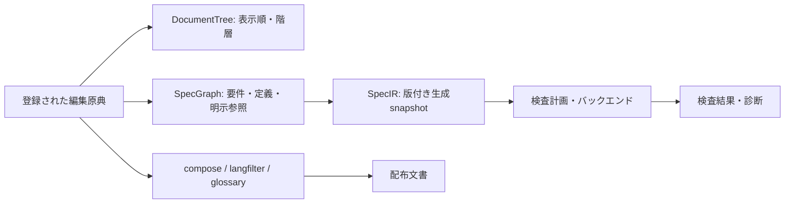
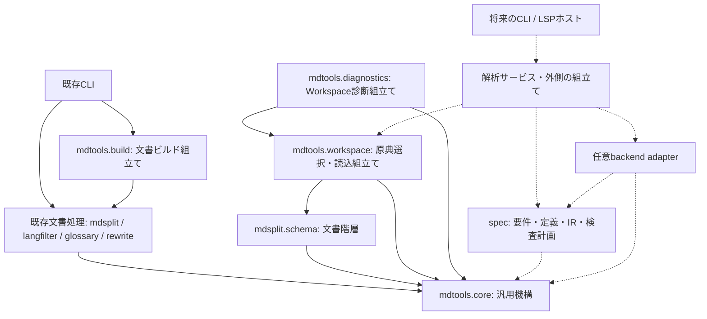

# mdtools 仕様記述契約 v1

契約ID: `mdtools-spec` / 契約版: **1** / 策定: 2026-10-25。

この文書は [M1 / #22](https://github.com/fischerimapig/mdtools/issues/22) の設計成果物である。原稿の書き方と後続実装の責務を定める。**M1 / #22では仕様パーサーや検査CLIは追加しない。**

## 契約の位置付けと適用範囲

本文の「必須」「禁止」は契約v1に対応する実装への要件を示す。「将来」「候補」は予約した拡張点であり、現在の対応機能を示さない。

| 段階 | この契約との関係 |
|------|------------------|
| M1 / #12 | 契約、Workspace、出典、診断、依存方向の基盤。#22は文書と例のみ |
| M2 / #13 | 要件・参照・共有定義の抽出、構造検査、SpecGraph/SpecIR、一覧・表示 |
| M3 / #14 | 式の型検査とZ3による有限領域の静的制約検査 |
| M4 / #15 | 編集支援、依存差分、対応確認と検査結果の鮮度管理 |
| M5 / #16 | 既存buildとの選択的な検査ゲート、CLI/CIと基本機能の統合 |
| M6〜M9 / #17〜#20 | CUE、Quint、Lean、LSPの順に任意の連携を追加 |

LLM API呼び出し、自然言語からの自動制約抽出、LLM Reviewer、本文と形式記述の意味的一致の自動保証は開発全体の対象外。汎用定理証明器の自作、任意のプログラムの自動検証も行わない。

## 原典と生成物

| 資料 | 責務と編集方針 |
|------|----------------|
| 単一Markdown/QMD | 明示的に登録した編集原典。本文と埋め込み形式記述を保持する |
| section原稿と`hierarchy.json` | section原稿は本文の原典、hierarchyは文書の順序・階層・ファイル参照の原典 |
| 共有定義 | 用語・型・変数・定数を人が宣言する原典。表示用glossaryと仕様用の型付き定義を区別する |
| Workspace設定 | 原典・共有定義・生成物の役割と解決ルートを登録する。#23のWorkspace設定v1と内部APIを使う |
| canonical文書・言語別配布物 | section運用ではcompose/buildの生成物。仕様解析の第二の入力にしない |
| SpecIR・バックエンド入力 | 原典から再生成する派生物。手編集した値を原稿へ暗黙に逆輸入しない |
| 検査結果・対応確認記録 | 入力snapshotに結び付く証跡。要件本文や形式記述の代替原典にしない |

単一文書と複数文書のどちらも明示登録で扱う。hierarchyを入口とする場合は参照されるpreambleとsection原稿だけを本文の解析対象にする。hierarchyのメタデータにあるfront matterは文書メタデータとして保持し、要件本文として走査しない。未参照ファイルや生成canonicalをディレクトリ走査で追加しない。

同じ文書のsection原稿とcanonicalの二重登録、同一ファイルの別名登録、未存在、解決ルート外の参照は診断する。相対パスの基準と生成物の識別方法は次節のWorkspace設定v1に従い、実行時のカレントディレクトリやファイル名の推測だけに依存しない。

仕様解析はlangfilter・glossary置換前の原稿に対して行う。日本語と英語の本文を同じ要件IDに保持し、言語抽出で失われた要件を検査対象から黙って除外しない。既存の文書運用ではsection編集後にcanonicalを再生成し、round-tripを検査する。

## Workspace設定 v1

M1 / #23は`mdtools.workspace.load_workspace(config_path)`を内部APIとして提供する。設定はUTF-8のTOMLとし、整数の`version = 1`を必須とする。契約版や共有定義版とは独立した版であり、未知の版、未知のフィールド、必須値の欠落、値の型の不一致、TOMLの重複キーを拒否する。暗黙の設定探索やディレクトリ走査は行わない。既存CLIの設定や終了コードは変更せず、新しい検査CLIもこの段階では追加しない。

```toml
version = 1
root = "."
generated = ["build/manual.en.qmd"]

[[documents]]
kind = "markdown"
path = "guidance.md"

[[documents]]
kind = "hierarchy"
path = "manual_sections/hierarchy.json"
canonical = "manual.qmd"

[[definitions]]
kind = "spec"
path = "shared/definitions.json"

[[definitions]]
kind = "glossary"
path = "shared/glossary.yaml"
```

| 設定 | 契約v1 |
|------|--------|
| `version` | 必須。Booleanや文字列ではなく整数`1` |
| `root` | 省略時は`"."`。設定ファイルの所在ディレクトリを基準に解決する、存在するディレクトリ |
| `documents` | 必須かつ1件以上の配列。登録順が文書順。各要素は`kind`と`path`を必須とする |
| `kind = "markdown"` | 単一の`.md`/`.qmd`原稿。複数登録すれば複数文書になる。`canonical`は指定不可 |
| `kind = "hierarchy"` | 既存DocumentTree形式のJSON。`canonical`を必須とし、その文書から生成するMarkdown/QMDの出力先を明示する |
| `definitions` | 省略時は空配列。各要素は`kind = "spec"`または`"glossary"`と`path`を必須とする。JSON/YAML/YMLを登録順に保持する |
| `generated` | 省略時は空配列。canonical以外の言語別配布物・生成IR等をパスの配列で明示する。canonicalをここへ再登録しない |

`root`以外のWorkspace設定内のパスは、すべて解決済みの`root`を基準にする。hierarchy内の`metadata.preamble_file`と各sectionの`file`だけは、そのhierarchyファイルのsymlink解決後の所在ディレクトリを基準にする。設定ファイル自体もsymlink解決後の所在ディレクトリからrootを解決する。絶対パスも受け付けるが、入力・生成物ともに解決後に`root`の内側でなければならない。`..`はこの範囲内で許可する。設定ファイルの所在ディレクトリはrootの外側でもよい。

パスはsymlinkと`.`/`..`を解決した絶対パスで保持する。環境変数、`~`、globを展開しない。設定ファイルの引数が相対パスの場合に限り、呼出時のCWDを基準に設定ファイル自体を探す。設定内のパスの意味は、以後のCWD変更で変わらない。サンプルは[キャンセル要件のmdtools.toml](examples/cancellation/mdtools.toml)を参照。

生成物の識別は`canonical`と`generated`への明示登録を根拠にする。hierarchyの`source_file`は従来の文書メタデータとして保持するが、パス解決・入力選択・出力先推定には使用しない。同名ファイルを探すこともしない。実際に別の場所へcompose/buildした配布物も、入力との衝突を検査するには`generated`に登録する。未登録ファイルの役割を内容やファイル名から推測することはしない。

hierarchyは既存の`DocumentTree`へ読み込む。`source_file`（文字列）、`base_level`（整数）、`metadata`（object）、`sections`（配列）は既存と同じ省略値を使う。sectionには`title`（文字列）、`file`（空でない文字列）、`order`（整数）が必須であり、`children`は省略時空配列とする。未知のhierarchy/sectionフィールド、JSONの重複キー、不正な構造はエラーとする。任意のmetadataは保持し、`front_matter`があれば文字列、`preamble_file`があれば空でない文字列を要求する。この検証はWorkspace入口で行い、既存mdsplitの読み込み方は変更しない。

本文の解析対象は、Workspaceの文書登録順に、単一原稿ならそのファイル、hierarchyならpreambleを先頭に置き、各兄弟の`order`で安定ソートした深さ優先のsection順に並べる。`order`が同じ場合はJSON配列内の順序を保つため、既存composeの順序と一致する。空のpreambleやsectionも参照されていれば対象に含める。未参照ファイル、hierarchy JSON、front matter、canonical、配布物は本文対象に加えない。front matterを含むメタデータは`DocumentInput.tree`のDocumentTreeに保持する。

未存在入力、通常ファイルでない入力、用途に合わない拡張子、解決ルート外の参照を拒否する。登録したhierarchy・preamble・section・単一原稿・共有定義・生成物を横断し、正規化パス、存在するファイルのデバイス番号とinodeで重複を検出する。symlinkやhard linkによる別名登録も対象とする。同一sectionの複数回参照や、共有定義のspec/glossary二重登録も後勝ち・黙った重複除去にしない。すべての生成物を入力より先に予約するため、canonicalと原稿の衝突は文書の登録順やcanonicalの存在有無に左右されない。生成物自体は未生成でもよく、読み込み時にディレクトリやファイルを作成しない。

APIの戻り値`Workspace`は`version`、`config_path`、`root`、`documents`、`definitions`、`generated`、`analysis_files`を持つ。各一覧はtuple、各パスは解決済みの`pathlib.Path`である。`documents`の要素`DocumentInput`は`kind`、`path`、hierarchyの場合の`canonical`と`tree`を持つ。`definitions`の要素`DefinitionInput`は`kind`と`path`を持つ。`generated`は文書登録順のcanonicalに設定の`generated`を続けた一覧、`analysis_files`は上記の順序の本文原稿パス一覧とする。共有定義は本文と混ぜず、`definitions`から別途取得する。定義の内容解析・名前衝突検査はM2の責務であり、YAML登録だけでPyYAMLを要求しない。langfilterやglossary置換も実行しない。

```python
from mdtools.workspace import WorkspaceError, load_workspace

workspace = load_workspace("docs/spec/examples/cancellation/mdtools.toml")
for path in workspace.analysis_files:
    print(path.relative_to(workspace.root).as_posix())
# cancel-allow.md / cancel-deny.md / guidance.md の順に各行を出力する。
```

異常時は`WorkspaceError(ValueError)`を送出し、部分的な一覧を返さない。`code`、`path`と説明文字列を持つWorkspace専用のエラーであり、#24の出典範囲や#25の共通診断・JSON出力は実装しない。同じ設定・ファイル状態に対して、設定検証、生成物予約、文書とその参照、共有定義の順で最初の異常を返す。

| エラーコード | 意味 |
|--------------|------|
| `workspace.invalid-config` | TOML、必須フィールド、未知フィールドや値の型が不正 |
| `workspace.unsupported-version` | 対応しない設定版（整数1以外） |
| `workspace.invalid-path` | 不正なパス文字列や解決不能なパス |
| `workspace.outside-root` | symlink解決後のパスがroot外 |
| `workspace.missing-file` / `workspace.not-file` / `workspace.not-directory` | 必要な入力・rootが存在しない、または期待するファイル種別でない |
| `workspace.invalid-extension` | 入力の用途またはcanonicalの拡張子が不正 |
| `workspace.invalid-hierarchy` | hierarchyのJSON・重複キー・構造が不正 |
| `workspace.duplicate-input` | 同じ実体の複数登録（生成物同士を含む） |
| `workspace.generated-input` | 生成物を原典またはhierarchyとしても登録している |
| `workspace.read-error` | 設定・hierarchyの読み込み、ファイル情報取得等のI/Oエラー |

このAPIはファイル登録と選択時点の検証であり、入力snapshotや内容hashを固定するものではない。後の読み込みまでのファイル変更・symlink差し替えは別途出典/snapshot基盤で扱う。診断0件を仕様内容の妥当性や検査成功とは表示しない。

## 要件ブロックの最小構文

要件はPandoc fenced divの`.requirement`で宣言する。IDと構文版は必須、`status`の省略値は`draft`とする。

````markdown
::: {.requirement #REQ-CANCEL-ALLOW spec-version=1 status=draft}
支払い済みで未発送なら、キャンセルを許可する。

```mdspec
{
  "version": 1,
  "id": "MODEL-CANCEL-ALLOW",
  "kind": "constraint",
  "uses": ["paid", "shipped", "cancel_allowed"],
  "when": "paid and not shipped",
  "must": "cancel_allowed == true"
}
```
:::
````

- 要件属性は`#ID`、`.requirement`、`spec-version`、`status`、任意の`refs`を認識する。`refs="REQ-A REQ-B"`は空白区切りの要件参照であり、制約の暗黙継承を意味しない。属性順序・引用符の有無で意味を変えない。
- IDは大文字小文字を区別する`[A-Za-z][A-Za-z0-9_.-]*`とする。要件IDはWorkspace全体で一意。ファイル名・見出し・章番号から生成し直さず、移動・並べ替えでも保持する。
- 本文は空にしない。本文だけの要件も有効であり、`mdspec`は任意。形式記述の省略は検査成功を意味しない。
- v1では要件に直接属する`mdspec`を最大1個とする。モデルIDはWorkspaceのモデル名前空間で一意とし、要件IDと区別する。複数のモデルを要する構文は将来の拡張として診断する。
- `mdspec`の内容はUTF-8のJSON objectとする。上の7フィールドを必須とし、`version`は整数`1`、`kind`は`constraint`、`uses`は一意な共有定義名の配列、`when`と`must`は空でない式文字列とする。未知の必須構文やフィールドを黙って捨てない。

この例で使う式の最小語彙はBooleanリテラル`true`/`false`、宣言した識別子、`not`、`and`、`==`である。演算子の結合は`not`、`==`、`and`の順とし、`when`と`must`はいずれもBooleanを要求する。`when`成立時に`must`を満たす条件付き制約として解釈する。自然言語から式を補完しない。

M2では式文字列と出典を保持する構造検査までを行い、型・式の対応可否や成立性は未検査と表示する。M3でBoolean・列挙型・有界整数、比較・論理結合の文法と型規則を追加文書化する。未対応の式をPythonの`eval`等へ渡さない。

多言語本文は一つの要件内に`::: {lang=en}` / `::: {lang=ja}`を子divとして置き、形式記述をその外側に1回だけ書く。[cancel-allow.md](examples/cancellation/cancel-allow.md) を参照。同じIDの要件を言語ごとに複製して登録しない。

## 予約構文と通常のコード例

仕様抽出では、通常の本文位置にある`.requirement`と、要件に直接属するinfo stringが厳密に`mdspec`のcode fenceだけを予約する。要件開始・終了のdiv fenceは3個のコロンとし、同じファイル内で閉じる。前後の空白は許容するが、開始属性の後や終了fenceの後に本文文字列を付けない。

| 入力 | 契約v1での扱い |
|------|----------------|
| 要件内の`mdspec` fence | 形式記述としてJSONを読む。閉じfenceは同じ記号で開始以上の長さ |
| 要件外の`mdspec` fence | 所属要件がないエラー。通常のコード例へ格下げしない |
| `json`、`python`、`cue`、`quint`、`lean`等のfence | 通常のコード例。仕様やバックエンド実行対象として取り込まない |
| `mdspec extra`等の不正info string | 予約語で始まる不正な形式として診断する |
| 外側のcode fence内に書かれた`.requirement`や`mdspec` | 表示用のリテラル。抽出しない。この契約の四重fenceの例も該当 |
| HTMLコメント・`<pre>`内、front matterの例 | 抽出しない。通常の説明内の文字列への部分一致でも起動しない |
| 要件のネスト、lang div内の要件 | v1では未対応として診断。一つの要件内の言語別本文は許可 |
| 要件がsectionファイルを跨ぐ、閉じfence不足 | 元原稿の構造エラー。composeしてから救済しない |

例示したい`mdspec`は、外側の四重以上のcode fenceの中に書く。要件内の言語divは正しく入れ子にし、対応する終了fenceを数える。モデルfenceは言語div内へ置かない。未知の`spec-version`、必須ID欠落、不正JSON、重複JSONキー、未知の属性・status・モデル種別は構造診断の対象とする。

壊れた予約構文を「要件が存在しなかった」ことにして解析成功を返してはならない。診断可能な範囲で残りの原稿を走査しても、該当範囲の結果には不完全であることを残す。通常の壊れたコード例を仕様エラーへ昇格させることも避ける。

## 共有定義と参照

表示用の用語・定数・記号は既存glossaryの`entries`スキーマを維持する。仕様用宣言は別のJSON/YAML文書とし、整数の`version: 1`と、`types`、`variables`、`constants`の4フィールドを必須とする。各宣言は名前から宣言内容へのmappingで、空の場合も`{}`を指定する。未知のフィールドや版は診断する。JSONでは追加依存を要求しない。YAMLは既存と同じ任意依存を利用する。

```json
{
  "version": 1,
  "types": {},
  "variables": {
    "paid": {"type": "bool", "role": "input"},
    "shipped": {"type": "bool", "role": "input"},
    "cancel_allowed": {"type": "bool", "role": "output"}
  },
  "constants": {
    "cancel_window_days": {"type": "int", "min": 0, "max": 30, "value": 14}
  }
}
```

型名は要件IDと同じ文字集合を使い、組み込み型名`bool`と`int`の再定義を禁止する。式から参照する変数・定数名は`[A-Za-z_][A-Za-z0-9_]*`とし、`true`、`false`、`not`、`and`、`or`を予約する。名前は大文字小文字を区別し、`types`・`variables`・`constants`を横断する重複名はエラーとする。

初期の型は`bool`、上下限を明示する`int`、`types`に`{"kind":"enum","values":["new","paid"]}`の形で宣言する列挙型とする。変数の`role`は`input`または`output`。整数には`min`/`max`を必須とし、`min <= max`を要求する。定数の`value`は宣言型と範囲を満たす値でなければならない。空の列挙・重複要素・未定義の型は診断する。列挙値や整数を使う式の文法と検査はM3の範囲である。

`uses`はモデルが使用する変数・定数名を明示する。式中の識別子は`uses`に含まれ、全参照が解決できなければならない。型依存は宣言から追跡する。要件の`refs`は要件名前空間に解決し、型・モデル・glossary IDへ偶然一致しても代用しない。循環参照があっても走査は停止し、要件参照の循環だけから論理矛盾を推定しない。

複数の仕様定義ファイルでの重複名、同一JSON/YAML文書内の重複キーはエラーとし、後勝ちで制約を消さない。仕様から利用するglossary IDも読み込み時に衝突を診断し、既存glossary CLIの「警告して後勝ち」と区別する。

glossaryの表示文字列を式・型・数値へ暗黙変換しない。仕様用の定数には明示型が必要であり、既存glossary定義に型を追加する移行は要求しない。glossaryとの明示的な関連付けの追加形式はM2で定める。

## DocumentTreeとSpecGraph

DocumentTreeは見出し、sectionの順序・入れ子、ファイル参照を表す既存`mdsplit.schema.DocumentTree`である。SpecGraphは要件、モデル、型・変数・定数、明示的な参照の関係を表す。文書の親子を要件の継承・依存・制約の適用範囲へ暗黙に変換しない。



SpecIRはSpecGraphを機械可読に出力する生成snapshotとする。契約版・IRスキーマ版・入力の識別と内容hash、要件ID・本文・形式記述・定義・出典・参照を保持し、同じ入力と設定から決定的な順序で生成する。式が未解析ならその文字列と未検査状態を保持し、型検査済みASTのように表示しない。

原稿の移動は出典の変更として表現し、要件IDは保つ。文書順序の変更と仕様内容の変更は区別する。IRや配布文書だけを編集しても原典の更新にはならず、再生成時に派生物が変わる。

## 状態と検査結果

一つの「verified」フラグで状態を集約しない。次の軸を独立して保持・表示する。

| 軸 | 最小状態と意味 |
|----|----------------|
| 要件ライフサイクル | `draft` / `active` / `deprecated`。承認済み・証明済みを意味しない |
| 形式化 | `natural-only`（本文だけ）/ `present`（形式記述あり）。存在と妥当性は別 |
| 構造・型 | `not-checked` / `valid` / `invalid` / `unsupported`。構造と型の結果は別に保持 |
| 個別の機械検査 | `not-run` / `passed` / `failed` / `unknown` / `unsupported` / `error` |
| 本文と形式記述の対応確認 | `unconfirmed` / `confirmed` / `stale`。人の明示的な確認記録 |
| 検査結果の鮮度 | `current` / `stale`。実行時snapshotと現在の入力の一致 |

ライフサイクルだけで検査対象から除外しない。除外する場合は検査計画で明示し、対象外一覧へ記録する。本文だけの要件は構造的に有効でも、論理検査は`not-run`、形式化は`natural-only`となる。

`passed`は特定の検査計画と対応範囲で成功した意味に限る。未導入は`not-run`と理由、タイムアウト・判定不能は`unknown`、実行失敗は`error`とする。未対応構文を除去して残りだけが成功した場合、全体を成功と表示しない。

対応確認は要件ID・本文・形式記述・推移的な参照定義のhashに結び付け、確認者と確認時点を保存する。本文だけ、形式記述だけ、依存定義だけの変更でも既存確認は`stale`となる。build/checkは確認記録を自動承認・更新しない。人の確認も意味的一致の機械的な証明にはならない。

検査結果には入力・依存定義・検査設定・コンパイラ/バックエンドの版を結び付ける。いずれかの変更後に過去の成功を現行結果として再利用しない。M1はこの契約を定め、鮮度管理・確認操作はM4で実装する。

## 検査範囲と保証の限界

機械検査は明示された形式記述だけを対象とする。記述されなかった条件、本文の誤読、単位や前提の取り違え、変換器・バックエンドの欠陥による見逃しを排除できない。本文に矛盾があっても形式記述に反映されていなければ検出できない。

反対に、適用範囲や共有変数を誤って宣言すると、意図では両立する要件が形式上衝突することがある。診断は「宣言されたモデルの衝突」とし、元の両要件・前提・共有定義・反例を示して人が判断できるようにする。本文の意味的矛盾を自動断定しない。

M3では少なくとも次を別の検査として扱う。

| 検査 | 判定の意味 |
|------|------------|
| 前提・入力領域の非空性 | 成立する入力がある。空集合による空虚な成功を防ぐ |
| 全体整合性 | 全制約を満たす割当てが少なくとも一つある。全入力の保証には足りない |
| 必須シナリオ | 指定した条件下で満たせる割当てがある |
| ルール適用可能性 | 各`when`が領域と前提の下で成立し得る |
| 有限入力領域の全域成立性 | 全入力について制約を満たす出力が存在する（∀input ∃output） |
| 指定した性質 | 前提と制約の下で性質の反例が存在するか。前提の整合性は別途確認 |

例の二要件は`paid=true, shipped=false`で出力に`true`と`false`を同時要求する。`paid=false`の割当てが存在して全体SATになっても、この入力での衝突を見逃してはならない。診断には両要件IDと元原稿を付ける。

SAT/UNSATの生値をそのまま成功/失敗に対応付けない。反例探索ではUNSATが対象性質の成立を表すことがあり、存在性検査ではUNSATが不成立となる。検査の種類・範囲・前提・未対応箇所・実行設定を結果に含める。充足不能コアは原因候補であり、必ず最小の原因集合だとは表示しない。

## 出典と診断の共通契約

#24のソースモデルは原稿URI/パス、snapshot、開始・終了位置を保持する。人向けの行・列は1-based、範囲は開始を含み終了を含まない。列はUnicode code pointで数え、バイト数やLSPのUTF-16単位と混同しない。日本語・絵文字・CRLFを含めて検証する。

出典は要件・形式記述・共有定義・式の各位置へ付ける。生成IR、compose/build出力、バックエンド入力の位置には元原稿への対応を保持する。生成された見出し・記号等に対応する実文字がない場合は合成位置として明示し、原稿に存在しない列を作らない。section原稿を入口にした診断の主位置は元sectionファイルとする。

#25の共通診断は安定した診断コード、重要度、メッセージ、主位置、関連位置、任意の要件IDと根拠を持つ。ユーザーが直せる構造/型エラーと、未対応・未実行・判定不能・ツール実行失敗を区別する。診断が0件でも、未実行の検査を成功としてはならない。

テキスト/JSONは同じ内容を表し、JSONにはスキーマ版を持たせる。パス、開始位置、診断コード、関連ID等による安定したソートを定める。出典のPython APIは以下の#24の契約、診断APIと出力・ソートは本節の#25の契約に定める。共通モデルはZ3/CUE/Quint/LeanやLSPのパッケージをimportしない。

M1 / #24は`mdtools.core.source`に以下の内部APIを追加する。共通診断・要件抽出・LSPの位置変換は追加しない。

| API | 契約 |
|-----|------|
| `SourcePosition(line, column)` | 正の整数による1-based位置。Boolean・浮動小数・0・負数を拒否する |
| `SourceRef(uri, snapshot, path=None)` | 絶対URIとsnapshot hashで出典を識別する。任意の補助パスは絶対PathでURIと一致させる。補助パスの有無は同一性に影響しない |
| `SourceSpan(source, start, end)` | 同じ出典の半開範囲。逆転を拒否し、空範囲を許可する。ファイル内に存在するかはsnapshotで検証する |
| `SourceSnapshot(uri, text, path=None)` / `from_path(path)` | 不変の原文と参照。ファイル読込はsymlink解決済み絶対パスとUTF-8を使い、改行やBOMを除去しない。不正UTF-8を拒否する |
| `snapshot.position(offset)` / `offset(position)` | Python文字列の0-based code point offsetと1-based位置の相互変換。範囲外とCRLFの途中を拒否する |
| `snapshot.span(start=0, end=None)` | offsetから範囲を作る。end省略時はEOF。引数なしなら全文範囲 |
| `snapshot.offsets(span)` / `slice(span)` | URI・snapshotと両端位置を検証し、offset対または原文を返す。別snapshotの位置を流用しない |
| `SourceMapping(generated, kind, original=None, reason=None)` | 生成範囲に対する対応。実原文のない対応にはoriginalを付けない |
| `SourceMap(artifact, inputs, mappings)` | 生成snapshot、依存する入力snapshot、全文を隙間・重複なく覆う対応のtuple。不変とし、対応の内容一致も構築時に検証する |
| `map.resolve(generated_span)` | 生成範囲を出典の境界で分割した`SourceMapping`のtupleを返す。複数ファイル・合成文字を一つの原稿範囲へ丸めない |
| `SourceMapBuilder` | 出力時に`add_source` / `add_synthetic` / `add_unmapped`で対応を記録し、`build(uri, path=None)`で生成物を固定する。文字列diffによる出典の推測はしない |

snapshotは**改行を含む原文をUTF-8にしたバイト列のSHA-256（小文字16進64桁）**とする。同じ本文の別sectionはhashが同じでもURIで区別する。ファイル移動は別出典、LF/CRLFの変更も別snapshotになる。原文を保持するため、読込後に実ファイルが編集されても古い範囲の参照先は変わらない。これは保存版番号・時刻・Workspace全体のhashではなく、最新状態の保証やキャッシュ再利用判定も行わない。

改行はLF・CRLF・単独CRを認め、いずれも行間の区切りとする。行末位置の列は本文code point数+1であり、CRLFのCRとLFの間には位置を作らない。改行自体は前行の行末から次行の1列目までの範囲になる。最終改行があればEOFは次の空行の1列目、なければ最終行の行末位置。空原稿の唯一の位置は`(1, 1)`。タブも1 code pointで数え、結合文字・絵文字列を表示幅やgrapheme clusterでまとめない。front matter・preamble・コードフェンスの除去や位置の再採番はしない。

`mdtools.workspace.snapshot_sources(workspace)`は`analysis_files`の順に本文原稿のsnapshot tupleを返す。生成物、hierarchy JSON、共有定義はこの本文一覧に加えない。設定・hierarchy・参照の登録を読み直して比較し、変化があれば`workspace.changed-input`でWorkspaceの再読込を要求する。本文の編集自体は許可し、その読込時の新snapshotを取得する。不正UTF-8は`workspace.invalid-source`、I/O失敗は`workspace.read-error`になる。共有定義は登録パスに対して`SourceSnapshot.from_path()`を別途使えるが内容解析はしない。

複数ファイルの読込はファイルシステムのatomic snapshotでもロックでもない。各snapshotは実際に読み込んだ内容を固定する。登録後の再検証は行うが、並行編集やsymlink差し替えとの競合を完全に防ぐものではない。未保存文書版、Workspace全体の鮮度管理、非同期結果の適用判定は後続Milestoneの責務とする。

```python
from mdtools.core.source import SourcePosition, SourceSpan
from mdtools.workspace import load_workspace, snapshot_sources

workspace = load_workspace("docs/spec/examples/cancellation/mdtools.toml")
allow, deny, guidance = snapshot_sources(workspace)
point = SourcePosition(1, 1)
assert SourceSpan(allow.ref, point, point).source != SourceSpan(deny.ref, point, point).source
assert allow.slice(allow.span()) == allow.text
```

M1で位置対応を実装する生成段階は**mdsplit compose単独**とする。`mdsplit.compose.compose_with_source_map(hierarchy_path, *, artifact_uri, base_level=None)`はファイル出力せず、従来の`compose()`と同じ文字列を`map.artifact.text`に持つ`SourceMap`を返す。`artifact_uri`は呼出側が生成段階を識別する絶対URIとして指定する。`source_file`から出力先を推測しない。両APIは同じ出力順・区切り処理を使う。既存CLI、hierarchy形式、欠落sectionのskip動作は維持し、厳密な登録検証にはWorkspaceを使う。

| 対応のkind | composeと共通モデルでの意味 |
|-----------|----------------------------|
| `exact` | section/preambleからコピーした実文字。生成範囲と原稿範囲の文字列が一致する |
| `newline` | 既存composeのuniversal newline読込に合わせ、原稿のCRLF/CRをLFへ正規化した一改行。元の改行全体へ対応する |
| `synthetic` | 生成見出し（`heading`）、挿入改行（`separator`）、JSONから復号したfront matter（`hierarchy-front-matter`）。reasonを必須とし、架空の原稿位置を付けない |
| `unmapped` | 位置変換を未実装の出力。reasonを必須とする。空生成物の唯一の位置も`empty-artifact`として未対応を返す |

hierarchyのfront matterや見出しタイトルにはJSON内の元文字列があっても、Markdownと同じ実文字列・列にはならないため、この段階ではそのJSON範囲へ対応付けない。代わりにhierarchyのsnapshotを`map.inputs`へ依存として保持する。本文にコピーしなかった空・空白のみのpreambleや空sectionも、読み込んだものは入力snapshotに保持する。

`resolve()`の空範囲は境界の右側、EOFでは最後の対応を選ぶ。合成文字の開始・末尾を隣の原稿へ勝手に寄せない。非空範囲は対応ごとに切り出し、呼出側が診断の主位置や関連位置を選べるようにする。原稿EOFから生成物EOFまでを無条件に対応させない。

```python
from mdsplit.compose import compose_with_source_map

mapped = compose_with_source_map(
    "docs/spec/contract-v1_sections/hierarchy.json",
    artifact_uri="memory:contract-compose",
)
for part in mapped.resolve(mapped.artifact.span()):
    if part.original is not None:
        print(part.original.source.uri, part.original.start)
    else:
        print(part.kind, part.reason)
```

このAPIはWorkspaceのsnapshot取得とは別に入力を読み込む。位置の参照には**当該mapの`inputs`**を使用し、前後に読んだ別snapshotへ範囲を流用しない。単一原稿の恒等対応には`SourceMapBuilder.add_source(snapshot)`を使える。compose時の改行正規化を行う場合のみ`normalize_newlines=True`を指定する。

buildのcompose段階までの文字列は上記APIで対応できるが、**langfilter、glossary置換、HTML書換え、decomposeでの元canonicalへの逆対応、生成IR・バックエンド入力への対応の実装は今回の範囲外**。build CLIへsource map出力や後段変換への伝播は追加しない。後段出力をこのmapに渡すとURI/hashの不一致を拒否する。未対応の変換を表現する呼出側は`add_unmapped(text, reason)`を使い、元原稿へ正確に追跡できるようには扱わない。最初に述べた生成IR等への対応は後続段階で満たす目標であり、M1で実装済みという意味ではない。

### M1 / #25 診断APIと検査状態

`mdtools.core.diagnostics`は外部依存なしの共通モデルと表示のみを持つ。M2以降の内容解析、要件解決、検査計画・鮮度管理、外部ツール実行、終了コード決定は行わない。

| API | 契約 |
|-----|------|
| `Diagnostic(code, severity, category, message, primary=DiagnosticLocation(), related=(), requirement_id=None, evidence=())` | 不変の診断。主位置・関連位置・要件ID・根拠を保持する |
| `DiagnosticLocation(kind="none", span=None, reason=None)` | #24の`SourceSpan`を包む出典情報。別の座標系は作らない |
| `DiagnosticLocation.from_mapping(mapping)` | exact/newlineは`mapping.original`を主位置候補にし、synthetic/unmappedは生成範囲と理由を保持する。複数断片からの主位置の選択は呼出側の責務 |
| `RelatedLocation(message, location, requirement_id=None)` | 別原稿・別snapshotも参照できる関連位置。意味を説明するmessageを必須とする |
| `Evidence(kind, message, location=None)` | 根拠種別と自由記述の事実・前提・理由。任意の位置を付けられる。反例等もmessageで記述できるが、coreは式の意味や真偽を解釈しない |
| `CheckResult(check_id, status, reason=None)` | 特定の検査と範囲を識別するIDごとの明示的な結果。診断数やseverityから計算しない |
| `DiagnosticReport(diagnostics=(), checks=(), sources=())` | 不変tupleによるレポート。全ての位置のsnapshotを保持・検証する。同一URIの異なるsnapshotを許す。未参照の依存snapshotも保持できる |
| `report_to_dict(report)` / `render_json(report)` / `render_text(report)` | 新しいJSON互換dict、末尾LF付きJSON、末尾LF付きテキストを返す。I/Oや実ファイルの再読込はしない |

`code`・`check_id`・根拠の`kind`は`[a-z][a-z0-9]*(?:[.-][a-z0-9]+)+`の識別子。生成側が名前空間ごとに管理し、同じcodeの意味を翻訳・message・severity・行番号に依存させない。意味を変える場合は新codeを割り当てる。既存Workspace診断の`workspace.*`コードは維持する。`example.*`は説明・テスト用で、仕様検査コードの予約ではない。message・理由・要件IDは空白だけの文字列を拒否する。UTF-8で表せない孤立surrogateも拒否する。

severityは表示上の`error / warning / info / hint`であり、検査の実行状態とは独立する。categoryは以下を区別する。

| category | 意味 |
|----------|------|
| `user` | ユーザーが原稿・設定を修正できる問題 |
| `unsupported` | 実装が対応しない版・構文・能力 |
| `unknown` | 判定不能・タイムアウト・入力変化等により結果を確定できない |
| `not-run` | 検査を実施していない。未導入等の理由をmessage/根拠に残す |
| `tool-error` | 読込・ツール実行・内部処理の失敗。仕様違反の判定とは分ける |

`CheckResult.status`は既存契約の`not-run / passed / failed / unknown / unsupported / error`を使う。not-run・unknown・unsupported・errorにはreasonを必須とし、passed・failedにも任意で付けられる。同じレポート内のcheck_id重複は拒否する。生成側が検査範囲・計画をIDと根拠で明確にし、実行済みの範囲に限ってpassedを設定する。coreは全体の成功を集約しない。checksが空なら検査状態の申告なしであり、診断0件でも成功にはならない。categoryは個々の診断の性質、statusは検査の結果であり、診断からstatusを暗黙変換しない。原稿の失敗はfailed、実行失敗はerrorとして生成側が対応を決定する。

位置のkindは`original / synthetic / unmapped / none`。originalは実原稿のspan必須・reasonなし。syntheticとunmappedはreason必須で、spanを持つ場合も生成物だけを指す。map構築前の失敗等で生成範囲も不明ならspanを省略する。noneは位置がない診断で、spanとreasonを持たない。全てのspanのURI/hashと範囲はreport.sourcesのsnapshotで検証し、欠落・不一致・存在しない行列を拒否する。関連位置・根拠の位置も同じ規則。補助パスの有無は#24の出典同一性を変えない。

#31は未解消であり、**断片末尾CR＋次断片先頭LFによって新しくCRLFができる境界**ではSourceMapBuilder.build()やcompose_with_source_map()が`ValueError: offset inside CRLF`で失敗し、map自体を取得できない。単一断片内のCRLF、通常のCRLF section本文全般の制約ではない。#25はこの修正を取り込まない。該当経路で呼出側が失敗を診断にする場合はtool-error / CheckResult.errorと理由を記録し、位置なし、またはspanなしのunmappedとする。近傍の原稿へ丸めたり、生成範囲から元原稿を推測したりしない。この経路を正確な原稿追跡が可能な経路として扱わない。

### 診断JSON v1とテキスト表示

JSONスキーマ版は整数`schema_version: 1`。[機械可読スキーマ](diagnostics-v1.schema.json)も参照する。公開Schemaもmessage・要件ID・理由の空白のみの値を拒否する。空白集合はPythonの`str.strip()`と同じく`U+0009–000D / U+001C–0020 / U+0085 / U+00A0 / U+1680 / U+2000–200A / U+2028–2029 / U+202F / U+205F / U+3000`を明示し、validatorごとに意味が異なる`\s`に依存しない。識別子とsnapshotの終端には`(?![\s\S])`を使い、末尾LFの直前も許す`$`による受理を避ける。開発依存のDraft 2020-12 validatorでSchema自体、生成JSON、不正文字列のモデルとの拒否一致をCIのpytestで検証する。レポートの必須フィールドは`schema_version / sources / checks / diagnostics`。空一覧も`[]`で残す。未知の版の読込やJSONデシリアライザーは今回実装しない。

| オブジェクト | 必須フィールド | 任意フィールド（値なしなら省略） |
|--------------|----------------|--------------------------------|
| source | `uri`, `snapshot` | `path` |
| check | `check_id`, `status` | `reason` |
| diagnostic | `code`, `severity`, `category`, `message`, `primary`, `related`, `evidence` | `requirement_id` |
| location | `kind` | `span`, `reason`（kindの規則に従う） |
| span | `source`, `start`, `end` | なし |
| start/end | `line`, `column` | なし |
| related | `message`, `location` | `requirement_id` |
| evidence | `kind`, `message` | `location` |

nullは出力しない。related/evidenceは空でも残す。span.sourceはsourceオブジェクトを直接含み、配列indexを使わない。sourcesにはURI・完全なSHA-256 snapshot・任意の絶対pathを出す。原文全体はメモリのreport.sourcesに保持し、**両形式とも原文textは出力しない**。出力したhashは読込内容の識別であり、実ファイルの現在の内容や結果の鮮度を保証しない。sourcesは依存一覧でもあり、未参照の入力も落とさない。

URIは#24の入力値をそのまま表示し、file URIのpercent encodingも勝手に復号・正規化しない。補助pathがあれば絶対パスを別フィールドで表示し、なければ省略する。相対化、cwd、OSのlocale、現在のファイル状態、時刻はソート・表示に使わない。JSONはオブジェクトキーを昇順、2空白indent、末尾LF、`ensure_ascii=False`で生成する。日本語・絵文字・結合文字を保持し、引用符・backslash・C0制御文字はJSONエスケープする。

診断のソートキーは順に、spanなしの真偽（ありを先）、主spanのURI、開始行、開始列、code、requirement_id（省略は空文字）、最後に**診断全体のcanonical JSON**。spanなしはURI空文字・行列0を内部ソートキーにするだけで、位置として出力しない。severity順による優先表示は行わない。終端位置、snapshot、category、message、関連位置、根拠等の差は最後のキーで区別する。完全一致の重複診断は削除せず同じ行を繰り返すため、同順位でも出力は変わらない。

canonical JSONはオブジェクトキー昇順、`ensure_ascii=False`、空白なし（separatorsは`,`と`:`）。relatedとevidenceは各要素のcanonical JSONで先に整列し、sourcesもsourceオブジェクトのcanonical JSON順、checksはcheck_id順にする。これらの一覧は意味上の順序を持たない。文字列比較はPythonのUnicode code point順で、自然順やlocale順ではない。入力tupleの挿入順を変えても同じ出力になる。

テキストは`diagnostics schema_version=1`、source行、check行、`diagnostic_count=N`、診断とそのrequirement_id・primary・related・evidence行の順。両形式は同じ正規化dictから全フィールドを表示する。範囲は`range=[開始行:列,終了行:列)`とし、全て1-based・code point単位。出典URI・snapshot・任意のpathも各位置に表示し、primary kind=noneを明示する。source/check/related/evidenceの0件は行を出さず、checkの成功行や全体成功文言を補わない。

テキスト中の自由文字列は全てJSON文字列として引用する。改行・タブ・引用符・backslashに加えてC1制御文字、Unicode行区切りU+2028/U+2029、bidi制御文字を`\uXXXX`表記にして、メッセージやファイル名が別レコードや表示方向に影響しないようにする。JSONとして復号した値は元の文字列と一致する。テキスト形式の読込APIは提供しない。

### 最小利用経路

`mdtools.diagnostics.inspect_workspace(config_path)`は既存のload_workspace→snapshot_sourcesを呼び、登録・本文読込の成否を`workspace.sources`チェックで返す。成功時はその範囲だけpassedで、仕様内容の検査は申告しない。WorkspaceErrorを共通診断に変換し、invalid-config/missing-file等はuser/failed、unsupported-versionはunsupported、changed-inputはunknown、read-errorはtool-error/errorとする。読めないファイルのsnapshotや行列を作らず、元のpathは`workspace.path`根拠として残す。既存Workspace APIの例外・既存CLIの出力・終了コードは変更しない。

```python
from mdtools.diagnostics import inspect_workspace
from mdtools.core.diagnostics import render_json, render_text

report = inspect_workspace("docs/spec/examples/cancellation/mdtools.toml")
print(render_text(report), end="")
print(render_json(report), end="")
```

実際に位置付き診断を作る呼出側は、snapshotとSourceSpanを渡す。以下は表示の例であり、衝突検出器を実行した結果ではない。

```python
from mdtools.core.diagnostics import (
    Diagnostic, DiagnosticLocation, DiagnosticReport, Evidence, RelatedLocation,
)
from mdtools.workspace import load_workspace, snapshot_sources

sources = snapshot_sources(load_workspace("docs/spec/examples/cancellation/mdtools.toml"))
allow, deny, guidance = sources
report = DiagnosticReport((Diagnostic(
    "example.conflict", "warning", "user", "両原稿を参照する表示例😀",
    DiagnosticLocation("original", allow.span(0, 0)),
    (RelatedLocation("関連原稿", DiagnosticLocation("original", deny.span(0, 0)), "REQ-CANCEL-DENY"),),
    "REQ-CANCEL-ALLOW", (Evidence("example.assumption", "表示例。意味検査は未実施"),),
),), sources=sources)
print(render_text(report), end="")
print(render_json(report), end="")
```

## 依存方向と既存CLIの互換性

矢印はimport・API利用の方向を表す。実線はM1の実装、点線は後続Milestoneの設計であり、未実装パッケージや新しいCLIは追加しない。



| 配置 | 責務と許される依存 |
|------|--------------------|
| `mdtools.core` | 汎用I/O、Markdown走査、Pandoc属性、SourceRef / SourceSpan / SourceSnapshot / SourceMap、診断のモデル・表示。core内と標準ライブラリに依存し、`core.io`だけがYAML入力時に任意のPyYAMLを遅延importする |
| `mdsplit` / `langfilter` / `glossary` / `mdhtml_rewrite`の処理本体 | 自ツールのモデル・変換・検証とcoreを利用する。文書階層は`mdsplit.schema`に残し、要件の依存関係モデルと分ける |
| `mdtools.workspace` | 設定・hierarchy登録を検証し、原典と生成物を区別して本文snapshotを取得する組立て層。`mdsplit.schema`と`core.source`を利用するためcoreへ移さない。定義のkind=specは登録分類だけで、内容の解析・要件ID解決を行わない |
| `mdtools.diagnostics` | Workspace固有の例外を共通診断と明示的な検査状態へ変換する組立て層。workspaceとcore診断に依存する。汎用モデル・ソート・JSON/テキスト表示は`core.diagnostics`に残す |
| `mdtools.build` | compose・言語抽出・表示用glossaryを順に呼ぶ文書生成の組立て層。各処理APIへ依存し、coreから各ツールを呼ばせない。Workspaceの登録や仕様検査は暗黙に実行しない |
| 既存CLIと互換入口 | 引数、stdin、最終出力先、表示、終了コードを担当し、上記の処理APIを呼ぶ。ファイルを扱う処理APIの読書きやbuildの中間ファイルは本体側の責務として維持する |
| 将来のspec層 | 要件抽出、要件ID・参照の解決、要件/制約の意味、IRと検査計画を担当し、coreのsnapshot・位置・診断を再利用する。既存文書処理の意味や出力規則を書き換えない |
| 将来の解析サービス・host・adapter | 解析サービスがWorkspace入力とspec処理を組み立て、外側で選択したadapterを渡す。CLI・LSPホストは同じサービス/APIと共通の診断結果を利用する。adapterはspecの入出力契約とcoreに依存し、外部backendの実行依存を閉じ込める |

coreと既存文書処理からCLI、workspace、診断組立て、build、spec、backendへ逆依存しない。coreから文書処理への依存、workspaceから診断組立てへの依存も作らない。specの処理本体はCLIや特定backend実装をimportせず、将来必要になった時点で外側から能力を渡す。汎用診断の`requirement_id`は不透明な付帯文字列で、IDの存在・一意性・意味をcoreで解決しない。severity、診断分類、検査状態は独立して維持し、診断0件から成功を推定しない。

M1 / #26では実際にCLI内に残っていたbuild本体とmdsplitの参照ファイル検証のみを分離した。既に独立しているcompose/decompose、langfilter、glossary、HTML書換えのモデル・処理API、workspaceと診断組立ての配置は維持する。将来用の空spec/backendパッケージ、汎用plugin機構、LSP変換、外部実行依存は作らない。既存glossaryの上書き・未定義ID警告やEPS変換の進捗表示は既存APIの副作用として維持するが、CLIのimportや新しい共通診断への一括移行は行わない。既存のgs/dvisvgm呼出は`mdhtml_rewrite.convert`に残し、新仕様用backendとは分ける。

CLIを経由しない利用例:

```python
from mdtools.build import build_document
from mdsplit.verify import verify

hierarchy = "docs/spec/contract-v1_sections/hierarchy.json"
verification = verify(hierarchy)  # section_count / missing_files。表示・終了なし
text = build_document(hierarchy, lang="en")  # 最終ファイルは書かずstrを返す
text_from_memory = build_document(input_text="::: {lang=en}\nHello\n:::\n", lang="en")
assert text_from_memory == "Hello\n"
```

`build_document(input_path=None, *, input_text=None, read_input=None, source_type="auto", base_level=None, lang=None, keep_lang_fences=False, defs=None, on_missing="error", work_dir=None, suffix=".md")`はファイルパス・input_text・遅延読込コールバックread_inputのいずれか一つを受け取る。read_inputは作業ディレクトリ準備後に呼び、CLIのstdin読込順も維持する。stdinや終了コードを扱わず、ValueError / OSError / GlossaryError / ResolveErrorは呼出側へ返す。`validate_build_options()`は段階選択を検証してcompose要否を返し、CLIがstdin読込前に既存の引数エラーを出せるようにする。引数違反は`BuildOptionsError(ValueError)`とし、入力probeの文字コード・内容エラーを引数エラーへ変換しない。suffixは中間ファイル名の拡張子だけで、CLIは従来どおり最終出力名・入力名から決める。work_dir指定時は中間ファイルを残し、未指定時は成功・失敗とも一時ディレクトリを破棄する。

`mdsplit.verify.verify(hierarchy_path)`は不変の`VerificationResult(section_count, missing_files)`を返す。格納順の深さ優先走査、重複する欠落参照、末尾のpreambleチェック、`Path.exists()`による従来の存在判定を維持し、Workspaceの厳格な登録検証へ置き換えない。読込・形式エラーは従来どおり伝播する。既存の`inspect_workspace()`、snapshot、source map、診断JSON v1と公開Schemaの契約も変更しない。Python APIは内部再利用境界であり、パッケージの新しい安定公開版を宣言するものではない。

既存互換性:

- 公開コマンド`mdtools` / `mdsplit` / `langfilter` / `mdhtml-rewrite` / `glossary`、統合サブコマンド、引数、入力形式、stdout/stderr、終了コード、ファイル形式、helpの短い例とREADME参照先を維持する。内部APIの設計説明はREADME・本契約へ置き、helpに新しい操作を追加しない。
- `mdsplit`はhierarchy形式、compose・decompose・verifyとround-tripを維持し、要件参照の意味を判定しない。verifyは成功・欠落一覧ともstdout、成功0・欠落1を維持する。
- `glossary`は表示用の用語置換と定義の後勝ち・警告を維持する。仕様用の重複禁止や明示型はspec層の契約であり、既存CLIへ持ち込まない。
- `langfilter`は既存の言語抽出を維持し、形式記述を検査しない。
- `mdtools build`は`compose → langfilter → glossary`の必要段階だけを実行し、中間ファイル保存・UTF-8再読込による既存の改行正規化を維持する。未定義IDのerrorは1、定義読込エラーは2、I/Oエラーは1、引数エラーは2を維持する。警告の文面・出力先も変えない。
- #31は未解消。断片末尾CR＋次断片先頭LFで新しくCRLFができると`SourceMapBuilder.build()` / `compose_with_source_map()`が失敗する。通常のCRLF本文全般の問題ではない。buildは従来の`compose()`を使い、map構築に切り替えない。該当mapを正確な原稿追跡として扱わず、診断化するhostはtool-error / errorと理由、位置なしまたはspanなしunmappedを使う。近傍原稿への丸めや架空の行列を作らず、修正は#31で扱う。
- `mdtools spec index/show/check/context`は後続Milestoneの予定であり、M1には存在しない。M5の選択的な検査ゲートも先取りしない。

依存方向は`mdtools/tests/test_boundaries.py`で本体の相対・関数内importと既存CLI dispatch表を含むグラフ、循環の不在、CLIを禁止した直接API呼出を検証する。`python -S`でsite packagesを除き、PyYAML・dev validator・backendなしのJSON/既存経路を検証する。PyYAMLは任意のYAML入力用、jsonschemaは公開Schema回帰のdev用のままで、必須実行時依存にしない。

## 将来のバックエンドとLSP

各連携は共通の要件ID・出典・診断・入力snapshot・鮮度・能力宣言を使う。共通メタデータと各形式の専用モデルを分け、すべての体系を一つの万能な式IRへ変換する契約にはしない。

| 連携 | 引き継ぐ境界と保証範囲 |
|------|------------------------|
| Z3 / M3 | Boolean・列挙型・有界整数の静的制約と検査計画。状態遷移の到達可能性は別 |
| CUE / M6 | 型・設定・データ制約。スキーマの矛盾と、具体値が未確定な状態を区別する |
| Quint / M7 | 明示的な初期状態・遷移・不変条件・到達条件。seed、探索深さ、有限範囲を記録し、シミュレーションとモデル検査を区別する |
| Lean / M8 | 前提・命題・証明宣言を要件に結び付ける。未完成証明・依存公理・信頼条件を確認し、証明成功を要件集合の無矛盾性と混同しない |
| LSP / M9 | CLIと同じ解析サービスを使い、未保存の複数ファイルsnapshot、文書版、位置エンコーディングを扱う。古い非同期結果を新しい編集へ適用しない |

backend adapterは識別子・バージョン・対応する検査種別・入力・結果・診断・再現設定を公開する。対応不能な式を黙って落とさず`unsupported`を返す。backend未導入でも既存文書処理と構造検査を使えるようにし、CUE/Quint/Leanの全実行環境を一律必須にしない。

直接記述した外部モデル・証明を原典にする場合は明示登録と依存追跡の対象にする。生成物と手書き証明を分離し、再生成で手書き部分を上書きしない。通常の`cue`/`quint`/`lean`コード例を勝手に実行・検査しない。実行や依存取得は明示操作とし、未信頼Workspaceの編集だけで起動しない。

M1ではこれらのadapter、外部ツール、LSPサーバーやプロトコル変換を実装しない。専用構文・ライブラリ・対応バージョンは各Milestoneで能力とともに確定する。

## バージョニングと開発フロー

契約版、Workspace設定版、共有定義版、IRスキーマ版、診断JSON版、パッケージのリリース版は別に管理する。同じ数字であることを要求しない。v1の要件は`spec-version=1`、モデルと仕様用共有定義は`version: 1`を明示する。未知の版を推測して読み込まない。

意味や既存入力の解釈を変える変更には新しい契約版と移行手順を用意する。対応部分を増やす変更も、何を理解できるかを能力として明示し、古い実装が未知の必須構文を成功扱いしないようにする。IRや検査結果のキャッシュには各版を記録する。

開発順は`master → spec-integration → milestone/<milestone> → issue/<番号>-<slug>`。サブIssueは対応するMilestoneブランチから分岐し、同ブランチへPRする。別サブIssueの未マージブランチを分岐元にしない。#22の作業ブランチは`issue/22-spec-contract`、PR先は`milestone/m1-foundation`。

サブIssueは受け入れとPRの**マージを確認してから**Closeする。PRを未マージでCloseしただけでは完了にしない。非デフォルトブランチ向けPRの自動Closeに依存せず、対象Issueを明記してマージ後に明示的にCloseする。Milestoneの必須サブIssue完了後に`spec-integration`へ統合し、統合後にMain IssueとMilestoneをCloseする。

| リリース | 手順 |
|----------|------|
| Phase 1（M1〜M5）| 基本機能を統合し、M5完了後に`spec-integration → master`へPR。暫定版は`v0.2.0` |
| Phase 2（M6〜M9）| Phase 1後のmasterをspec-integrationへ同期。M6〜M9を順次統合し、M9完了後に2回目の`spec-integration → master`へPR。暫定版は`v0.3.0` |

各MilestoneのCloseはPhaseのリリースPRを前提としない。新しいMilestoneブランチは開始時点のspec-integrationから作る。版番号は受け入れ時に調整でき、pyprojectの変更やタグをM1で先行作成しない。タグはリリースPRが実際にマージされたコミットを指す。

## 例と受け入れの対応

[キャンセル要件の原稿と共有定義](examples/cancellation/README.md) は、この契約をレビューするための編集可能な最小例である。M1時点では実行済みの検査結果を含まない。

| 例・変更 | 後続実装で確認すること |
|----------|------------------------|
| cancel-allow.md + cancel-deny.md | 条件`paid=true, shipped=false`での出力衝突を両要件・両原稿位置に戻す（M3） |
| guidance.md | 自然言語のみを抽出でき、形式化済み・検査成功とは表示しない（M2〜M3） |
| 四重fence内の要件例、通常のJSONコード例 | 要件や形式記述として抽出しない（M2） |
| 要件ID重複・未定義refs/uses・不正JSON・未知の版 | 元原稿の構造診断となり、後勝ちや無視で成功しない（M2） |
| 要件・mdspecの閉じ忘れ、section跨ぎ、ネスト | 元ファイルで診断し、composeによる結合で補わない（M2） |
| 未対応式・backend未導入・タイムアウト | unsupported / not-run / unknownと理由を表示する（M3以降） |
| 本文・形式記述・依存定義の個別変更 | 対応確認と過去の検査結果をstaleとして扱う（M4） |
| 原稿移動・見出し変更・並べ替え | 要件IDを保ち、出典や文書構造の変更と内容差分を区別する（M2〜M4） |

M1 / #22の検証は文書のリンク・例のJSON・既存CLIでの文書round-tripと回帰テストに限定する。表の将来の検査が実装済みであるかのように受け入れ記録へ付け替えない。
