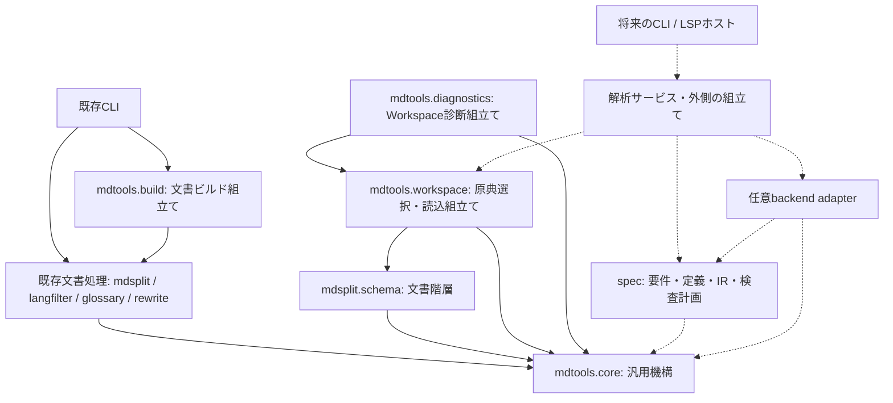

矢印はimport・API利用の方向を表す。実線はM1の実装、点線は後続Milestoneの設計を示す。M2 / #35でspecのモデル・結果型を追加したが、抽出器・Graph構築器・解析サービス・新しいCLIはまだ存在しない。



| 配置 | 責務と許される依存 |
|------|--------------------|
| `mdtools.core` | 汎用I/O、Markdown走査、Pandoc属性、SourceRef / SourceSpan / SourceSnapshot / SourceMap、診断のモデル・表示。core内と標準ライブラリに依存し、`core.io`だけがYAML入力時に任意のPyYAMLを遅延importする |
| `mdsplit` / `langfilter` / `glossary` / `mdhtml_rewrite`の処理本体 | 自ツールのモデル・変換・検証とcoreを利用する。文書階層は`mdsplit.schema`に残し、要件の依存関係モデルと分ける |
| `mdtools.workspace` | 設定・hierarchy登録を検証し、原典と生成物を区別して本文snapshotを取得する組立て層。`mdsplit.schema`と`core.source`を利用するためcoreへ移さない。定義のkind=specは登録分類だけで、内容の解析・要件ID解決を行わない |
| `mdtools.diagnostics` | Workspace固有の例外を共通診断と明示的な検査状態へ変換する組立て層。workspaceとcore診断に依存する。汎用モデル・ソート・JSON/テキスト表示は`core.diagnostics`に残す |
| `mdtools.build` | compose・言語抽出・表示用glossaryを順に呼ぶ文書生成の組立て層。各処理APIへ依存し、coreから各ツールを呼ばせない。Workspaceの登録や仕様検査は暗黙に実行しない |
| 既存CLIと互換入口 | 引数、stdin、最終出力先、表示、終了コードを担当し、上記の処理APIを呼ぶ。ファイルを扱う処理APIの読書きやbuildの中間ファイルは本体側の責務として維持する |
| spec層 | M2 / #35でモデル・結果型を実装。要件抽出、要件ID・参照の解決、要件/制約の意味、IRと検査計画は後続で実装し、coreのsnapshot・位置・診断を再利用する。既存文書処理の意味や出力規則を書き換えない |
| 将来の解析サービス・host・adapter | 解析サービスがWorkspace入力とspec処理を組み立て、外側で選択したadapterを渡す。CLI・LSPホストは同じサービス/APIと共通の診断結果を利用する。adapterはspecの入出力契約とcoreに依存し、外部backendの実行依存を閉じ込める |

coreと既存文書処理からCLI、workspace、診断組立て、build、spec、backendへ逆依存しない。coreから文書処理への依存、workspaceから診断組立てへの依存も作らない。specの処理本体はCLIや特定backend実装をimportせず、将来必要になった時点で外側から能力を渡す。汎用診断の`requirement_id`は不透明な付帯文字列で、IDの存在・一意性・意味をcoreで解決しない。severity、診断分類、検査状態は独立して維持し、診断0件から成功を推定しない。

M1 / #26では実際にCLI内に残っていたbuild本体とmdsplitの参照ファイル検証のみを分離した。既に独立しているcompose/decompose、langfilter、glossary、HTML書換えのモデル・処理API、workspaceと診断組立ての配置は維持する。将来用の空spec/backendパッケージ、汎用plugin機構、LSP変換、外部実行依存は作らない。既存glossaryの上書き・未定義ID警告やEPS変換の進捗表示は既存APIの副作用として維持するが、CLIのimportや新しい共通診断への一括移行は行わない。既存のgs/dvisvgm呼出は`mdhtml_rewrite.convert`に残し、新仕様用backendとは分ける。

CLIを経由しない利用例:

```python
from mdtools.build import build_document
from mdsplit.verify import verify

hierarchy = "docs/spec/contract-v1_sections/hierarchy.json"
verification = verify(hierarchy)  # section_count / missing_files。表示・終了なし
text = build_document(hierarchy, lang="en")  # 最終ファイルは書かずstrを返す
text_from_memory = build_document(input_text="::: {lang=en}\nHello\n:::\n", lang="en")
assert text_from_memory == "Hello\n"
```

`build_document(input_path=None, *, input_text=None, read_input=None, source_type="auto", base_level=None, lang=None, keep_lang_fences=False, defs=None, on_missing="error", work_dir=None, suffix=".md")`はファイルパス・input_text・遅延読込コールバックread_inputのいずれか一つを受け取る。read_inputは作業ディレクトリ準備後に呼び、CLIのstdin読込順も維持する。stdinや終了コードを扱わず、ValueError / OSError / GlossaryError / ResolveErrorは呼出側へ返す。`validate_build_options()`は段階選択を検証してcompose要否を返し、CLIがstdin読込前に既存の引数エラーを出せるようにする。引数違反は`BuildOptionsError(ValueError)`とし、入力probeの文字コード・内容エラーを引数エラーへ変換しない。suffixは中間ファイル名の拡張子だけで、CLIは従来どおり最終出力名・入力名から決める。work_dir指定時は中間ファイルを残し、未指定時は成功・失敗とも一時ディレクトリを破棄する。

`mdsplit.verify.verify(hierarchy_path)`は不変の`VerificationResult(section_count, missing_files)`を返す。格納順の深さ優先走査、重複する欠落参照、末尾のpreambleチェック、`Path.exists()`による従来の存在判定を維持し、Workspaceの厳格な登録検証へ置き換えない。読込・形式エラーは従来どおり伝播する。既存の`inspect_workspace()`、snapshot、source map、診断JSON v1と公開Schemaの契約も変更しない。Python APIは内部再利用境界であり、パッケージの新しい安定公開版を宣言するものではない。

既存互換性:

- 公開コマンド`mdtools` / `mdsplit` / `langfilter` / `mdhtml-rewrite` / `glossary`、統合サブコマンド、引数、入力形式、stdout/stderr、終了コード、ファイル形式、helpの短い例とREADME参照先を維持する。内部APIの設計説明はREADME・本契約へ置き、helpに新しい操作を追加しない。
- `mdsplit`はhierarchy形式、compose・decompose・verifyとround-tripを維持し、要件参照の意味を判定しない。verifyは成功・欠落一覧ともstdout、成功0・欠落1を維持する。
- `glossary`は表示用の用語置換と定義の後勝ち・警告を維持する。仕様用の重複禁止や明示型はspec層の契約であり、既存CLIへ持ち込まない。
- `langfilter`は既存の言語抽出を維持し、形式記述を検査しない。
- `mdtools build`は`compose → langfilter → glossary`の必要段階だけを実行し、中間ファイル保存・UTF-8再読込による既存の改行正規化を維持する。未定義IDのerrorは1、定義読込エラーは2、I/Oエラーは1、引数エラーは2を維持する。警告の文面・出力先も変えない。
- #31は未解消。断片末尾CR＋次断片先頭LFで新しくCRLFができると`SourceMapBuilder.build()` / `compose_with_source_map()`が失敗する。通常のCRLF本文全般の問題ではない。buildは従来の`compose()`を使い、map構築に切り替えない。該当mapを正確な原稿追跡として扱わず、診断化するhostはtool-error / errorと理由、位置なしまたはspanなしunmappedを使う。近傍原稿への丸めや架空の行列を作らず、修正は#31で扱う。
- `mdtools spec index/show/check/context`は後続Milestoneの予定であり、M1には存在しない。M5の選択的な検査ゲートも先取りしない。

依存方向は`mdtools/tests/test_boundaries.py`で本体の相対・関数内importと既存CLI dispatch表を含むグラフ、循環の不在、CLIを禁止した直接API呼出を検証する。`python -S`でsite packagesを除き、PyYAML・dev validator・backendなしのJSON/既存経路を検証する。PyYAMLは任意のYAML入力用、jsonschemaは公開Schema回帰のdev用のままで、必須実行時依存にしない。
