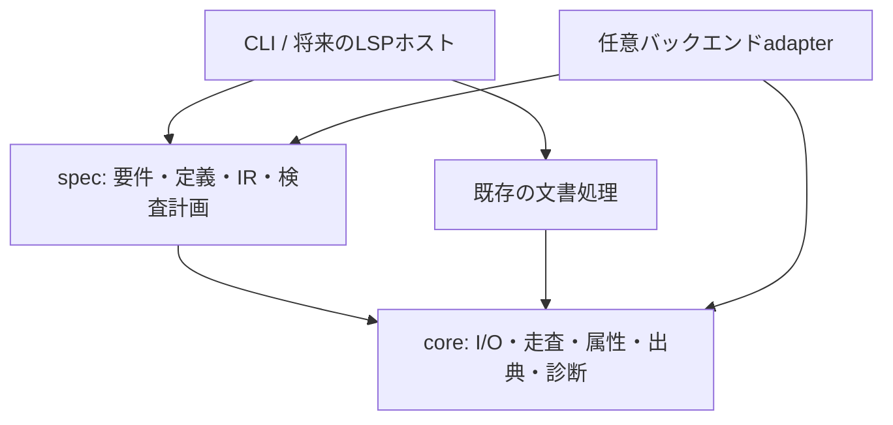

`core`には一般的な機構を置く。要件IDの解決、制約の意味、検査計画は`spec`に置く。CLIは引数と表示、サービスは解析と検査を担当する。coreや既存文書処理からspec・CLI・バックエンドへ逆依存させず、外側の組立て層が必要なadapterを渡す。具体的なパッケージ境界の整理は#26で行い、大規模な移動を先行させない。

- `mdsplit`は既存hierarchy形式・compose・decompose・verifyとround-tripを維持し、要件参照の意味を判定しない。
- `glossary`は表示用の用語置換を維持する。仕様用の重複禁止や明示型は新しいspec読み込みの契約であり、既存CLIの後勝ち規則を変更しない。
- `langfilter`は既存の言語抽出を維持し、形式記述の検査を行わない。
- `mdtools build`は配布文書生成の入口を維持する。現在の`compose → langfilter → glossary`の順序、入力形式、出力、終了コードを#22で変更しない。M5の検査ゲートは選択的に追加する。
- `mdtools spec index/show/check/context`は後続Milestoneで実装する予定の入口。この契約の利用に今すぐ実行するコマンドではない。新CLIの終了コードは実装時に版付きの契約として文書化する。
